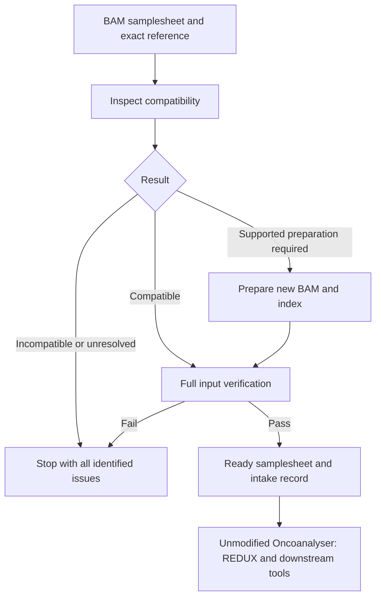

# BAM intake and preparation for native Oncoanalyser

Owner direction: November10,2026. Status: **implemented in the v0.2.0 BAM entry;
synthetic Slurm integration tested; full KQ0205 intake/execution pending**.
This document owns the intake requirements. The
site launch entry, resource policy and scientific source remain documented in
[NATIVE_BAM_ENTRY.md](NATIVE_BAM_ENTRY.md).

## Problem

KQ0205's native REDUX jobs failed because both imported BAMs lacked mate-CIGAR
tags. Oncoanalyser3.0.0 documents that requirement. The existing launcher checked
file presence/size and prepared resources but did not enforce the downstream
input requirements. A successful graph preview did not inspect BAM records.
This was an omitted intake step, not evidence that64 CPUs or REDUX were faulty.

Do not resume this by adding patient-specific fixes to launch commands. Develop
one maintained intake/preparation path for every imported BAM. Its output must
be accepted before starting expensive analytical tasks. Existing frozen runs
and successful reference preparation remain preserved.

## One public entry

The public BAM launcher orchestrates this dependency
automatically. The user supplies the manifest/reference once. A manually
prepared PASS file or a different launcher must not bypass intake. The native
scientific pipeline remains unchanged. The shared native launcher also rejects
alignment paths without matching verified intake and reference bindings.

## Requirements and outcomes

Only requirements needed to read/process the data are launch blockers. Ordinary
warnings and scientific QC findings are not automatically fatal.

| Area | Required evidence | Outcome if unmet |
|---|---|---|
| BAM readability and completeness | Header/EOF check plus a full successful record traversal under Slurm; quickcheck alone is insufficient | Reject unreadable/truncated input; retrieve the complete source |
| Sorting/index | Actual coordinate ordering and a usable matching index | Supported sort/index preparation on a new output; preserve source |
| Sample binding | Samplesheet tumour/normal roles agree with the source mapping and read-group SM values; every read's RG resolves where required | Stop for explicit source-backed mapping; never infer a biological pair from filenames alone |
| Exact reference | BAM sequence names/lengths agree with the configured FASTA; compare available M5 values and source reference identity as well | Stop on mismatch/unknown identity; contig agreement alone does not prove sequence identity |
| Mate-CIGAR | Valid MC tags on primary/supplementary paired mapped records whose mates are mapped; secondary records are preserved but not processing targets | Prepare missing/incorrect valid-form mate information with a pinned tool; reject malformed CIGAR strings |
| Supplementary clipping | Supplementary alignments meet native soft-clipping requirements; inspect records, not only a recorded `-Y` command | Stop for an appropriate alignment/input route; changing a CIGAR string does not recover missing sequence |
| Platform tags | Required tags for the explicitly selected technology; Illumina must not inherit SBX/Ultima-only requirements | Use a validated platform preparation or stop with the exact missing requirement |
| Enabled branches | Correct build-specific resource files/indexes; CRAM decoding requirements if CRAM is selected; RNA reference/annotation compatibility if RNA is selected | Report the affected input/resource requirement; never silently omit the requested branch |

The MC requirement comes from native `docs/usage.md` and the installed REDUX
failure. Its exact record scope must be covered by mapped/unmapped fixtures.
Checking tag presence does not establish that its value matches the actual
mate. A mate-information preparation must calculate that value from the mate,
and verification must include native read-validation behavior and synthetic
expected values.

Before implementing additional hard failures, cite the pinned downstream tool's
requirement. Do not introduce a blanket requirement for every optional SAM tag,
fail on every Picard warning, or turn scientific fit advisories into input errors.
Unknown required compatibility is unresolved, not PASS.

## Inspection, preparation, verification

1. Cheap header/index checks and a bounded record probe collect all detectable
   compatibility issues before scheduling a full scan or preparation. A probe
   can demonstrate a failure; a clean probe is not a full-file PASS.
2. Execute required whole-file inspection/preparation under Slurm, with resources
   based on source volume, reference and eligible hardware. Collect counters
   during required traversal instead of adding redundant bulk reads solely to
   manufacture validation evidence. Full traversal must establish the checks
   that sampling cannot prove.
3. Use a versioned preparation table. Initial supported operations to implement
   and test are mate-information generation and coordinate sorting/indexing.
   Native documentation recommends Picard FixMateInformation for missing MC.
   It also updates mate-related fields, so do not describe it as an MC-only edit.
4. Write new BAM/index outputs; preserve source files, sequences, QUAL/OQ tags,
   read groups and records. No recalibration, consensus, read filtering,
   duplicate removal or realignment is authorized by this technical preparation.
   REDUX remains the subsequent native processing stage.
5. Verify outputs: record conservation, sequence/quality preservation, unchanged
   reference/sample binding, coordinate order/index usability and resolution of
   the original compatibility issues. Permit and enumerate only the mate-field
   changes the chosen operation is documented to make. Fail rather than hide
   unexpected losses or changes.
6. Emit one prepared-input manifest and machine-readable intake record. Each
   finding is explicit: PASS, PREPARATION_REQUIRED, INCOMPATIBLE or UNKNOWN.
   Release to REDUX only after both paired inputs have completed verification.

A test of record preservation may require name-collated comparison or
order-independent record-content accounting; coordinate-order changes are not
read loss. Do not claim exact conservation from output file sizes or a bounded
read sample. Use established tools for the BAM transformations rather than
inventing record edits. Tool-specific threading limits matter: reserving64 CPUs
does not make a serial Picard operation64-threaded.

## Reuse and the producer boundary

Keep source file identities, exact reference identity, preparation/tool versions,
counter summaries, actual commands and output bindings in the intake record.
Reuse an unchanged, verified prepared input; changed data/reference/tool rules
require a new applicable verification. File modification time alone is not
cryptographic content identity. Avoid repeated whole-BAM hashing when an already
verified transfer/content identity is available and bound to an immutable input.

For future BAM production, add the applicable consumer requirements to the
export step and test its output through this same intake contract. This does
not mean every historical `analysis_ready.bam` is invalid for its original
pipeline. It means readiness for one consumer does not establish readiness for
another. Historical BAMs use the maintained adapter; no case-specific exception.

## Acceptance before the next BAM release

- Synthetic BAMs cover missing/incorrect MC, mapped/unmapped mates, discordant
  pairs, supplementary clipping, missing/mixed read groups, reference mismatch,
  broken/missing index, truncated data and a valid unchanged input.
- Tests cover both supported preparation and incompatible cases, source/sequence/
  quality preservation, no unexpected record loss and an input changed after
  previous verification.
- Integration proves that a failing input starts **no REDUX/caller tasks**, and
  that the launch entry consumes the verified manifest rather than raw paths.
- A representative real pair completes the intake and native REDUX; a complete
  whole-genome run then establishes downstream compatibility. Unit tests and
  preview alone do not satisfy that final acceptance.

Technical compatibility does not guarantee a reportable PURPLE fit, tumour
purity, sensitivity, concordant interpretation or clinical clearance. Preserve
native scientific QC and report eligibility after intake succeeds.

## Sources

## Implemented v0.2.0 interface and verification

`workflow/bam_intake.py`, `bam_intake_audit.cpp` and
`bam_intake_worker.sbatch` implement the stage. The public BAM launcher submits
one input-sized Slurm preparation job per explicitly bound DNA sample, waits
for both, verifies their receipts and publishes the prepared samplesheet. The
shared native launcher checks that the actual paths/reference match those
receipts. It rejects raw BAM paths, changed prepared inputs and bounded-probe
evidence. A dispatcher lock prevents duplicate preparation submissions.

The released scope is paired Illumina DNA BAMs. CRAM, RNA alignments and other
platforms stop before analysis until their mappings are implemented. Existing
FASTQ-only runs remain unaffected. New prepared BAMs and indexes go under
`inputs/prepared_bams_v0.2.0/<sample>/`; originals remain at their source paths.
The prepared samplesheet is `state/intake_prepared_samplesheet.csv`.

Tools: samtools1.22.1 and GATK4.6.1.0's Picard FixMateInformation, using the
already installed container. Query-name sorting is lexical (`samtools sort -N`)
for Picard compatibility. GATK writes a normal BAM file; its stdout contains
completion text and must not be used as a binary transport stream. Coordinate
sorting/indexing follows. The exact generated mate-fixed intermediate is
removed only after successful output verification. Source BAMs are never
modified or deleted.

Reference verification hashes the configured FASTA against its published
SHA256, derives a fresh sequence dictionary from that FASTA and compares the
supplied dictionary. Header sequence M5 values are compared where present.
Older BAMs lacking complete M5 require an unambiguous source-PG FASTA declaration;
the receipt explicitly records that provenance basis, without claiming header
M5 proof. Unknown/conflicting declarations fail.

A20,000-record probe can reject an incompatible input early. Full source and
prepared traversals then run under Slurm. A streaming C++ counter reads samtools
SAM output and feeds standard `samtools checksum` processes; it neither edits
records nor implements a new checksum algorithm. Order-independent checks cover
all records, names, sequences, qualities including OQ, flags except documented
mate-related bits, MAPQ/CIGAR and all non-mate auxiliary tags. A second checksum
covers mapped coordinates. Picard can position unmapped reads beside their mate,
so unmapped coordinates are not asserted invariant. MC/MQ and mate fields are
recomputed from actual mates. Standard samtools CRC conservation is not a claim
of cryptographic file identity. Output counts, coordinate order, tag requirements,
index readability, reference/sample binding and source immutability are also checked.

Initial intake requests:64 CPUs/192GiB, walltime rounded up to4h using
`max(24h, source_BAM_GiB/4*1.5h)`, capped at240h. This is a conservative declared
4GiB/hour end-to-end allowance with1.5 safety margin, not a measured throughput
model. Sorting uses up to63 threads; Picard's serial/GC behavior is preserved.

Slurm test job12441700 completed with exit0: **24 tests pass** using the actual
tools. Coverage includes missing/wrong/malformed MC, secondary/supplementary and
unmapped records, duplicates/QC-fail reads, invalid sample/reference/platform,
hard clipping, missing/broken index, truncation, unchanged valid input and
rejection of deliberate sequence, QUAL, OQ, MAPQ and record-loss mutations.
Integration checks reject bypass/raw paths and prove an intake failure prevents
the analytical launcher. Full KQ0205 preparation/native execution remains the
real-data acceptance step.

The frozen failed execution/reference tasks are preserved. The resumed head
waits for the previous head's terminal state before opening the same Nextflow
cache; `-resume` can reuse successful reference tasks. Original manifests and
logs remain in their original package. FASTQ transfers are independent.

## Source references

- [Oncoanalyser3.0.0 usage](https://nf-co.re/oncoanalyser/3.0.0/docs/usage/#sequencing-technologies):
  BAM requirements, custom genomes and CRAM requirements. Local pinned source:
  `7c74c87a43749952b38c9a18915947570f0595a0`, `docs/usage.md`,
  `lib/Utils.groovy`, `modules/local/redux/main.nf`.
- [Picard FixMateInformation](https://gatk.broadinstitute.org/hc/en-us/articles/21905095539867-FixMateInformation-Picard):
  documented mate-information preparation and ADD_MATE_CIGAR option.
- [Observed KQ0205 execution](../tests/results/native-bam-input/EXECUTION.md):
  both native REDUX failures and actual64-core requests.
