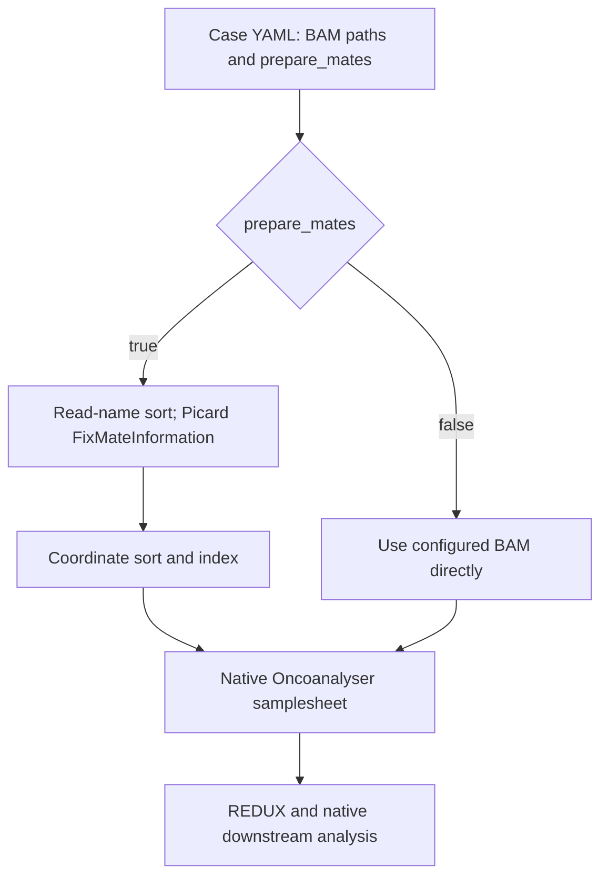

# BAM preparation and native execution

Owner direction, November10,2026: **remove the custom initial validation and
final audit, including their launch gates. Use explicit YAML inputs and the
standard tools.** This supersedes v0.2.0's mandatory full-file verification.
Current implementation: BAM entry **v0.3.0**.

## What runs



Use [the example YAML](../samplesheets/bam_case.example.yaml). Each row carries
the native sample fields and `prepare_mates: true` or `false`. False uses the
specified BAM directly, including a previously prepared BAM. True writes a
new BAM/index using samtools1.22.1 and GATK4.6.1.0 Picard FixMateInformation.
The input BAM is not modified. The exact configured custom reference remains
in `workflow/conf/d1_vd1.config`; it is not inferred from filenames.

There is **no** custom BAM scan, record probe, checksum/conservation comparison,
reference SHA/M5/header validator, output audit or receipt-based release gate.
No custom quickcheck/idxstats stage is added. Standard sorting, Picard, indexing
and Oncoanalyser errors still stop execution. Their native input handling and
scientific QC are unchanged. Preparation is recorded as PREPARED, not a claim
that independent conservation or biological validation passed.

The removed C++ audit is retained only in Git history and historical frozen
packages. Do not reintroduce it, including its faster experimental version,
as a routine patient-processing requirement.

## Entry

```bash
sbatch --account=def-hpcg6049_cpu \
  workflow/run_bam_oncoanalyser_frontenac.sbatch \
  example_bam_run /absolute/path/to/case.yaml
```

The entry submits mate-preparation jobs only for rows marked true, waits for
their ordinary successful Slurm completion, writes a native CSV and invokes
stock Oncoanalyser3.0.0 with `-resume`. Already configured BAM rows need no
custom receipt or signature. `preparation.json` and `dispatch.json` are logs,
not independent validation requirements.

Preparation retains the existing measured-input resource policy:64 CPUs,
192GiB, initial hours rounded up to4h from
`max(24h, source_BAM_GiB/4*1.5h)`. This conservative historical envelope has
not been recalibrated after audit removal. Native heavy-step input-adjusted
resources remain unchanged. Slurm and native Nextflow logs record execution.

## Existing work and development tests

KQ0205's completed v0.2.0 normal BAM/index are reused explicitly in its YAML;
its abandoned final audit is not relabelled PASS. The tumour starts directly
with mate preparation. Original BAMs and completed native reference-index work
are preserved. Frozen old scripts/logs remain historical evidence, not the
current route. See [execution evidence](../tests/results/native-bam-input/EXECUTION.md).

Code-development tests exercise YAML mapping, Picard mate tags, sequence/quality
preservation on tiny synthetic data and ordinary tool failure. They are not
patient workflow stages. This policy concerns the custom BAM adapter only;
it does not remove native scientific QC or alter separately maintained raw
FASTQ lane/completeness rules in another workflow.

Native source: nf-core/oncoanalyser3.0.0,
`7c74c87a43749952b38c9a18915947570f0595a0`, `docs/usage.md`, sequencing
technologies/BAM section: mate-CIGAR tags are required; Picard
FixMateInformation is the documented example repair. Native requirements
remain tool requirements; this adapter adds no parallel validation engine.
