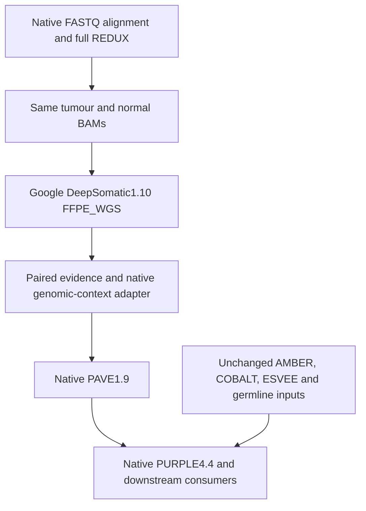

# Replace the somatic call producer, preserve native downstream tools

Owner direction,10 November2026. Development branch: `hartwig_adoptation`.
This is an isolated experiment, not a default caller change or a report release.
Both full native KQ0205 workflows keep running unchanged.

## Smallest boundary

Only **SAGE_SOMATIC's variant-discovery output** is proposed for replacement.
SAGE_GERMLINE remains native. PAVE, PURPLE, structural calling, RNA and other
native branches retain their tools, references and resource bundle. DeepSomatic
does not replace SAGE with a differently named SAGE file alone.

Native source: nf-core/oncoanalyser3.0.0,
`7c74c87a43749952b38c9a18915947570f0595a0`:

- `subworkflows/local/sage_calling/main.nf`: `SAGE_DIR_TUMOR` skips somatic
  discovery independently of germline discovery.
- `subworkflows/local/pave_annotation/main.nf`: resolves the compatibility
  filename `<tumour>.sage.somatic.vcf.gz` and passes it as generic `-input_vcf`
  to `modules/local/pave/somatic/main.nf`. PAVE1.9 remains the annotator.
- `subworkflows/local/orange_reporting/main.nf`: requires a somatic SAGE
  directory as well as PURPLE and other native products. A valid VCF is not
  proof that every SAGE side file exists or is meaningful for a new caller.
- `modules/local/sage/append/main.nf`: native append measures additional
  samples, normally RNA after PURPLE. Its ability to accept a DeepSomatic VCF
  and preserve caller tumour fields is not yet established; do not assume it
  can replace the previously tested paired-count adapter.

## Reuse established work, verify the new version boundary

The November9 experiment already prepared actual paired DeepSomatic counts,
native SAGE ReferenceData tiers/hotspots and native reference-repeat context,
then ran PAVE1.9/PURPLE4.3 on three GI cases. Corrected native-reference inputs
gave4207/5198/4783 fitting variants. That is useful prior evidence, not an
end-to-end Oncoanalyser3.0/PURPLE4.4 demonstration.

Reference and source:
`somatic_pipeline_sm/docs/qc/gi_esvee_comparison_20261109/HARTWIG_NF_IMPORT_REVIEW.md`;
`../dnaseq_nf-purple-adapter-20261109/research/purple_adapter/`, component0.6.1,
`7093033`. Read-only reuse/review; no modification of that scientific checkout.
Do not import its old2.3.0 process definitions into this3.0.0 experiment.

| Dependency | Handling |
|---|---|
| Matched reference/BAMs | Use the new full FASTQ route's REDUX tumour/normal and exact HMF masked FASTA; old d1.vd1 callsets cannot stand in for this caller comparison. |
| FFPE caller | Existing official Google1.10.0 GPU image, `--model_type=FFPE_WGS`; no Parabricks engine substitution. |
| Normal evidence | Raw caller output has one tumour sample. Reuse real normal AD/DP measurement, retaining missing/positive support; never synthesize clean0/0. |
| Region/hotspot/repeat annotations | Reuse native5.0.2 helper logic with the current3.0 bundle. No blanket tier, zero repeat, or invented phasing/read-context values. |
| DeepSomatic FILTER/GT/AD/DP/VAF | Preserve raw output. A downstream accepted-somatic view can select real PASS/non-reference calls; never convert non-PASS calls to PASS. |
| PAVE population/PON/effects | Use real current native resources and preserve its actual added filters. Earlier no-filter experimental flags are not silently transferred. |
| Germline calls | Keep native SAGE germline; normal counts at somatic loci are not a germline callset. |
| TINC, coverage, phasing and report side files | Inventory exact native reader requirements before full substitution. Do not fabricate SAGE outputs, assume absent TINC means measured zero, or use a SAGE control's caller-dependent metric as a DeepSomatic result. |
| REDUX preprocessing/model domain | Preserve native REDUX for this surgical comparison. Software completion does not establish that the FFPE model's accuracy is unchanged on consensus/unmapped REDUX reads; compare callsets and appropriate truth material separately. |

## First actual caller test

Maintained entry: `workflow/test_deepsomatic.py` with
`workflow/test_deepsomatic.sbatch`, component0.1.0. It runs Google's official
`run_deepsomatic` directly on explicit paths, preserving all output FILTERs.
No new environment, image download, alignment or original-BAM modification.

The first test calls20Mb: chr17:1–10000000 and chr19:1–10000000, using the **full
FASTQ run's** completed REDUX BAMs with indexed regional reads. It is not a
downsampled BAM or a whole-genome caller result. The bounded scope uses16 CPUs,
128GiB, one GPU and4h. Twenty Mb is about0.6% of a human genome; compressed
whole-BAM bytes are recorded as context, not misrepresented as measured regional
read counts. These are conservative small-test limits, not full-WGS sizing.
Future whole-genome example preparation must be input-sized and use64 CPUs on
CPU nodes, with GPU inference allocated separately if eligible GPU hardware
cannot supply64 CPUs.

The GPU mask is passed explicitly through Apptainer's clean environment.
Postprocessing is bounded to allocated CPUs and3times as many partitions.
`execution.json` records inputs, model, exact command, Slurm ID, exit code and
raw VCF sample/FILTER/FORMAT/INFO summaries. A valid zero-call result remains
a valid observation. No report, annotation adapter or native rerun is triggered.

Execution root:
`/global/scratch/hpc6049/wigits_runs/deepsomatic_seam_20261110/`.
Exact issued source, input JSON and scheduler evidence are external. Completion
and downstream compatibility remain pending until demonstrated.

## Remaining increments

1. Confirm the official model runs on these native-reference REDUX BAMs and
   record observed GPU use and raw output contract.
2. Apply the established paired/context adapter using current resources;
   prove tumour payload preservation and real normal counts.
3. Run native PAVE1.9/PURPLE4.4 in a separate directory, reusing unchanged
   native AMBER/COBALT/ESVEE and germline products. First reproduce the same
   native control with current versions, then change only somatic VCF input.
4. Resolve every SAGE side-output consumer through real measurements or an
   explicit supported absence. Do not silently disable branches to claim success.
5. Only after the comparison, add an optional caller selector at this single
   boundary and perform full-scope integration tests. SAGE stays the default
   until an explicit adoption decision. Caller concordance is not clinical
   validation or evidence of identical sensitivity.

Primary Google source: [DeepSomatic1.10 runner](https://github.com/google/deepvariant/blob/r1.10/scripts/run_deepsomatic.py)
and [FFPE paired-WGS example](https://github.com/google/deepsomatic/blob/r1.10/docs/deepsomatic-case-study-ffpe-wgs.md).
