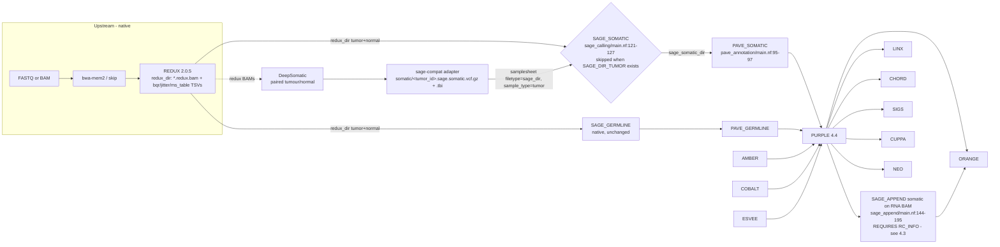

# DeepSomatic → oncoanalyser wiring contract (SAGE_SOMATIC substitution)

Status: draft for review — 2026-11-11. Scope: oncoanalyser **3.0.0** (commit `7c74c87a43`), hmftools **sage 5.0.2 / pave 1.9 / purple 4.4 / orange 5.0.1**.
Evidence: (1) real outputs of the completed route-B run `KQ0205_full_bam_custom_20261109_r1` (VCF headers read from disk); (2) oncoanalyser source in the cluster clone; (3) hmftools source at tags `pave-v1.9` and `purple-v4.4` (monorepo snapshot also used for sage/orange/sigs/cuppa/neo/chord). Every file:line anchor below was read, not recalled. Companion evidence table: `sage_tag_consumers.tsv` (every source line that reads a SAGE tag).

Boundary (unchanged from `docs/DEEPSOMATIC_SUBSTITUTION.md`): **replace only the SAGE_SOMATIC discovery output.** REDUX, AMBER, COBALT, ESVEE, SAGE_GERMLINE, PAVE, PURPLE, LINX, ORANGE and everything else stay native.

## 1. The seam, as oncoanalyser actually wires it

Facts the diagram rests on:

| Fact | Anchor |
|---|---|
| SAGE_SOMATIC runs only when the tumour has no existing `SAGE_DIR_TUMOR` input; SAGE_GERMLINE is gated independently on `SAGE_DIR_NORMAL`. Supplying a `sage_dir` for the tumour therefore skips **only** somatic calling. | `subworkflows/local/sage_calling/main.nf:76-81,121-127` |
| SAGE_SOMATIC emits the directory `somatic/` containing `<tumor_id>.sage.somatic.vcf.gz`; with TINC on (WGS, Illumina, tumour+normal) also `<tumor_id>.sage.somatic.fit_variant.tsv`. Observed route-B contents: exactly `.vcf.gz`, `.vcf.gz.tbi`, `.fit_variant.tsv`. | `modules/local/sage/somatic/main.nf:28,56-69,104`; disk listing |
| PAVE_SOMATIC resolves `<sage_dir>/<tumor_id>.sage.somatic.vcf.gz` and `.tbi` by name — nothing else is read from the directory. | `subworkflows/local/pave_annotation/main.nf:95-97` |
| PAVE command: `-sample <tumor_id> -input_vcf … -pon_file -pon_artefact_file -gnomad_freq_dir -clinvar_vcf -driver_gene_panel -mappability_bed -ensembl_data_dir`. | `modules/local/pave/somatic/main.nf:54-72` |
| In WGTS mode SAGE_APPEND re-genotypes the **PURPLE** somatic VCF against the RNA BAM (`-input_vcf <purple.somatic.vcf.gz> -reference <rna_id> -reference_bam <rna.bam>`), so adapter fields propagate to it. | `subworkflows/local/sage_append/main.nf:144-195`; `modules/local/sage/append/main.nf:40-56` |
| `fit_variant.tsv` is read only inside SAGE's TINC code; no reader in purple 4.4, orange, or hmf-common. Not required by the substitute. | grep: only `sage/tinc/TincConfig.java`, `VariantCache.java` |
| ORANGE declares `-sage_dir`/`-sage_germline_dir` but no file read from them was found in the orange source snapshot. | `orange/OrangeConfig.java:314-315` |

## 2. What SAGE 5.0.2 really writes (route B, observed)

- Sample columns: `#CHROM … FORMAT KQ0205-gDNA KQ0205-DNA` — **normal first, tumour second**; names are the oncoanalyser `normal_id`/`tumor_id`. Downstream resolves columns by name (`hmf-common/…/GenotypeIds.java:71-104`), so order is convention, names are contract.
- INFO (23): `GND_FREQ, LPS, LPS_RC, MED, MH, MQF, MSG, NEARBY_INDEL, PON_COUNT, PON_MAX, PON_MULTI, PON_READS, RC_INFO, RC_MH, RC_NM, RC_REPC, RC_REPS, REP_C, REP_S, TIER, TINC_RECOVERED, TNC, TQP`
- FORMAT (19): `AD, AED, AF, AFBQ, AFMQ, ARCBQ, ARMQ, ASBQ, DP, FSB, GT, MUC, RC_CNT, RC_IPC, RC_JIT, RC_QUAL, RSB, SAC, UMI_CNT`
- FILTER (25): `PASS, dedupIndel, dedupMatch, dedupMixedGermlineSomatic, dedupMnv, dedupSnvMnv, fragmentLength, fragmentStrandBias, jitter, mapQualRefAltDiff, maxEdgeDistance, maxGermlineAltSupport, maxGermlineRelQual, maxGermlineVAF, minAvgHpQual, minAvgRawBaseQual, minAvgT0Qual, minFragmentCoords, minGermlineDepth, minMQF, minTumorQual, minTumorSupport, minTumorVAF, readStrandBias, realignFrequency`
- PAVE 1.9 adds INFO `CLNSIG, CLNSIGCONF, IMPACT, MAPPABILITY, PAVE_TI` and FILTER `PON, PONArtefact, PONGnomad`; PURPLE 4.4 adds INFO `BIALLELIC, BIALLELIC_PROB, HOTSPOT, KT, NEAR_HOTSPOT, PURPLE_AF, PURPLE_CN, PURPLE_GERMLINE, PURPLE_MACN, PURPLE_VCN, REPORTABLE_TRANSCRIPTS, REPORTED, SUBCL`. Both carry every SAGE field through unchanged (identical FORMAT set in all three files).

## 3. Field-level consumer map (what breaks if a field is missing)

Severity: **BLOCK** = consumer crashes or silently produces a wrong headline result; **DEGRADE** = a feature is lost; **NONE** = carried through, unread.

| SAGE field | Consumer and behaviour (verified) | Severity if absent |
|---|---|---|
| sample columns `tumor_id`, `normal_id` with `GT`, `AD`, `DP` | `AllelicDepth.fromGenotype` **asserts `AD` present** (`AllelicDepth.java:36-42`); PURPLE builds tumour and reference depth per variant (`purple/somatic/SomaticVariant.java:33-37`). A sample column without `AD` is a hard failure; a missing normal column yields `NO_DEPTH` (reference alt count 0). | BLOCK (AD) |
| `AD` of the normal | PURPLE fit excludes any variant with `referenceAlleleReadCount() > 0` (`SomaticPurityFitter.java:212-216`). Without real normal counts, germline leakage is not screened at fit time. | DEGRADE (fit quality) |
| `FILTER` = `PASS` | PAVE skips non-PASS records unless tier is HOTSPOT/PANEL (`pave/ChromosomeTask.java:185-188`); PURPLE, SIGS, CUPPA, CHORD use PASS only. | BLOCK semantics |
| `TIER` (HOTSPOT/PANEL/HIGH_CONFIDENCE/LOW_CONFIDENCE) | Missing → `UNKNOWN` (`VariantTier.java:18-21`). PURPLE fit **rejects UNKNOWN/LOW_CONFIDENCE** unless hotspot (`SomaticPurityFitter.java:170-198`) ⇒ *a VCF without TIER contributes zero variants to somatic purity fitting*. PAVE: PON thresholds are per tier (`PaveConfig.java:157`, `ChromosomeTask.java:286`), hotspot reportability = `tier()==HOTSPOT` (`Reportability.java:52-59`), non-PASS retention (above). | BLOCK |
| `REP_C`, `REP_S` | PURPLE fit drops `repeatCount() > SNV_FITTING_MAX_REPEATS` (`SomaticPurityFitter.java:200-204`); PURPLE MSI counts indels by `REP_C`/`len(REP_S)` (`MicrosatelliteIndels.java:69-70`); CUPPA indel-driver rule (`cup/…/DriverPrep.java:145`); PAVE realignment context (`VariantData.java:189-190`). | BLOCK for MSI, DEGRADE for fit |
| `TNC` | PURPLE kataegis (`KataegisEnrichment.java:50-53`); SIGS SNV96 buckets (`SigSnvLoader.java:189`); CUPPA SNV96 (`cup/somatics/SomaticVariant.java:82`). | BLOCK for signatures/CUPPA SNV features |
| `MH` | PAVE indel realignment/HGVS positioning (`VariantData.java:208`). CHORD computes homology itself from the reference (`chord/indel/IndelDetails.java:73-80`), not from `MH`. | DEGRADE (PAVE) |
| `LPS` | PAVE phasing → MNV / phased-inframe effects (`VariantData.java:187`); PURPLE phased reporting (`SomaticStream.java:324,354`); ORANGE phased-variant grouping (`orange/…/PurpleVariantFactory.java:80-109`). | DEGRADE (no phased calls) |
| `RC_CNT` (FORMAT) | NEO parses it per genotype and **throws** if it is not a 6-element list (`neo/…/SomaticVariant.java:69-80`). Only matters when NEO is enabled. | BLOCK for NEO only |
| `RC_INFO` | SAGE_APPEND rebuilds the read context from it (`sage/vcf/CandidateSerialisation.java:84-130`; `ReadContextVcfInfo.fromVcfTag` returns null unless 6 `-`-separated items, `:62-71`). Without it SAGE_APPEND (RNA depth in WGTS) cannot run. | BLOCK for SAGE_APPEND / ORANGE RNA depth |
| `RC_REPC`, `RC_REPS`, `MQF`, `GND_FREQ`, `PON_*`, `TQP`, `MED`, `MSG`, `NEARBY_INDEL`, other `RC_*`, `UMI_CNT`, quality FORMAT fields | SAGE read-context/quality internals; `MQF`/`GND_FREQ` read only in PAVE PON-generation and TINC paths; PON/gnomAD annotation is recomputed by PAVE from its own resources. | NONE |
| `QUAL` | No selection logic in PAVE/PURPLE reads it; ORANGE displays it. | NONE (set to DeepSomatic QUAL) |
| `fit_variant.tsv` | SAGE-internal TINC output. | NONE |

## 4. The adapter contract (`deepsomatic → sage-compat`)

### 4.1 Inputs
- DeepSomatic paired-mode VCF (tumour genotype column only; `GT:GQ:DP:AD:VAF:PL`; FILTER ∈ PASS / RefCall / GERMLINE / low-quality classes) produced from the **REDUX** tumour and normal BAMs with the HMF `GRCh38_masked_exclusions_alts_hlas.fasta` (contig set must equal the FASTA `.dict`).
- The REDUX **normal** BAM (normal `AD`/`DP` at every emitted site).
- Native SAGE resources from `hmf_pipeline_resources.38_v3.0.0--8`: `KnownHotspots.somatic.38.vcf.gz`, `DriverGenePanel.38.tsv`, Ensembl data cache, `HighConfidence.38.bed.gz`.
- The reference FASTA.

### 4.2 Output (hard requirements — all "MUST")
1. Path: `<sage_dir>/<tumor_id>.sage.somatic.vcf.gz` + `.tbi`, bgzip/tabix, sorted in FASTA `.dict` contig order. The directory is passed in the samplesheet as `filetype=sage_dir`, `sample_type=tumor`, `sequence_type=dna`.
2. Two genotype columns named exactly `normal_id` then `tumor_id` (route-B order), each with `GT`, `AD` (Number=R), `DP`, `AF`. Tumour values from DeepSomatic; normal values from a pileup of the normal REDUX BAM at the same sites (MAPQ/BQ thresholds recorded in the header).
3. `INFO/TIER` from SAGE's own `TierSelector` with the native resources (Codex's `NativeSageRegions.java` already does this; reuse it).
4. `INFO/REP_C`, `INFO/REP_S` from the reference with SAGE's `RepeatInfo.findMaxRepeat` parameters (Codex's `ReferenceRepeatAnnotator.java`); `INFO/TNC` from the reference; `INFO/MH` for indels from reference flanks.
5. `FILTER`: `PASS` for DeepSomatic PASS; non-PASS records kept **only** when TIER is HOTSPOT or PANEL, with their DeepSomatic FILTER string declared in the header. Everything else is dropped before writing (PAVE/PURPLE would drop them anyway).
6. Header: declare every INFO/FORMAT/FILTER used, `##contig` lines copied from the FASTA `.dict`, `##source=deepsomatic-<ver>+sage-compat-<ver>`, and a `##sage_compat_adapter_*` block recording tool versions, resource SHA256s and normal-pileup thresholds. Multiallelic records split before annotation (the Codex adapter's AD/DP/VAF projection check applies).
7. Not fabricated: `LPS`, `RC_INFO`, `RC_CNT`, `RC_QUAL`, `RC_JIT`, `UMI_CNT`, quality FORMAT fields, `PON_*`, `GND_FREQ`, `MQF`, `TQP`. Their absence is declared in the header and handled per 4.3.

### 4.3 Known feature gaps and the chosen mitigation
| Gap | Effect | Mitigation in v1 |
|---|---|---|
| No `LPS` | No phased MNV / phased-inframe reinterpretation in PAVE, PURPLE, ORANGE | Accept; state in the run README. Read-backed phasing is a later increment. |
| No `RC_INFO` | SAGE_APPEND somatic cannot run → no per-variant RNA depth in ORANGE, no NEO RNA support | WGTS substituted runs: disable the somatic SAGE_APPEND task for the case (`task.ext.when` in a site config scoped to substituted runs), **or** run SAGE_APPEND on the native SAGE VCF restricted to the DeepSomatic PASS set. Synthesising a reference-based `RC_INFO` (AlignmentStart, VarIndex, flanks + core, cigar) is feasible per `CandidateSerialisation.toCandidate` but untested — experimental. |
| No `RC_CNT` | NEO throws | Keep NEO excluded for substituted runs until `RC_CNT` = `[AD_alt,0,0,0,AD_ref,DP]` is validated against NEO's `VariantReadSupport` ordinals. |
| No TINC | `TINC_RECOVERED` never set | Accept. |
| Normal `AD` from pileup, not SAGE read-context counting | Slightly different germline-leak screen | Record thresholds; compare against SAGE normal `AD` on the intersection set (§6). |

## 5. Execution wiring (two options)

**Option A — two-pass, zero oncoanalyser code change (recommended for validation now)**
1. Pass 1: oncoanalyser WGTS with the normal samplesheet and `--processes_include alignment,redux` (produces `redux_dir` for tumour and normal, incl. BQR/jitter/ms_table TSVs).
2. DeepSomatic on the two REDUX BAMs (Slurm; resources per `deepsomatic_performance_review.md`) → adapter → `sage_dir`.
3. Pass 2: same run directory, `-resume`, samplesheet extended with `redux_dir` rows (tumour, normal) and one `sage_dir` row (tumour). SAGE_SOMATIC is skipped (§1), SAGE_GERMLINE/PAVE/PURPLE/… run natively on the REDUX BAMs and the adapter VCF.

**Option B — single pass, in-pipeline** (after Option A validates): local modules `DEEPSOMATIC` + `SAGE_COMPAT_ADAPTER` in a subworkflow that replaces the `runnable` branch of `sage_calling` for the tumour when `params.somatic_caller == 'deepsomatic'`, emitting `[meta, somatic/]` on the same channel. This is an oncoanalyser patch (same mechanism as the isolated `v3.0.0-qlmp.1` ORANGE patch) and needs a GPU executor label on Frontenac (`def-hpcg6049_gpu`).

**Input-quality finding (performance review, 2026-11-11):** the native REDUX tumour BAM of KQ0205 carries 84–86 % soft-clipped reads (mean clip ≈ 60 bp; raw FASTQs, FFPE inserts mostly < 151 bp) versus 8–14 % in the fastp-trimmed Parabricks BAM of route A, at equal depth. DeepSomatic `make_examples` costs 3.5× more CPU per candidate on that input and emits ~2× the candidates. This is a property of the alignment entry (oncoanalyser does not trim adapters; it relies on soft-clipping), so it is a contract decision, not a tuning knob: (i) trim adapters before the native aligner — changes the BAM for SAGE/ESVEE too and must be validated against route C; (ii) accept the cost and set resources per the review; (iii) feed DeepSomatic a hard-clipped copy of the REDUX BAM — native tools untouched, one extra step. Owner decision pending; the §6 pilot should be run on (ii) and (iii).

Either way the DeepSomatic inputs are the REDUX BAMs, not the aligner BAMs: REDUX is the pipeline's duplicate/consensus layer and every other tool reads `redux_dir` (`lib/Utils.groovy:872`). Check before the first run: whether REDUX leaves duplicate-flagged reads (DeepSomatic drops 0x400 reads by default) and whether consensus-read base qualities shift DeepSomatic's calibration — compare candidate counts on the 20-Mb pilot between aligner BAM and REDUX BAM.

## 6. Validation plan (KQ0205, native route C vs substituted route D)
1. Adapter unit checks: `bcftools view -h` + `gatk ValidateVariants`; sample names; contig order; every record has `TIER`, `REP_C`, `REP_S`, `TNC`, both `AD`.
2. Tier parity: on SAGE∩DeepSomatic PASS sites, `TIER` agreement ≥ 99 % (Codex audit saw 3/5/2 tier changes per pool after the native-reference correction — explain any remainder).
3. PURPLE: purity, ploidy, `purple.qc` status/warnings, number of fitting variants (run PURPLE once with `-log_level TRACE`; `logFilteredFittingCandidate` reasons are logged), MSI indels/Mb, TMB, TML, driver catalog diff.
4. Downstream: SIGS exposures, CUPPA top-3, CHORD HRD status, LINX unchanged (SV path untouched), ORANGE PDF section diff.
5. Record everything under `tests/results/deepsomatic-substitution/KQ0205_<date>/` with the adapter header block copied in.

## 7. Out of scope
- Replacing SAGE_GERMLINE (different consumers: PAVE germline, PURPLE germline, PEACH, ORANGE germline tables).
- Changing PAVE/PURPLE resources or filters to accommodate DeepSomatic.
- Targeted/panel mode (`-high_depth_mode`, PON artefacts) — WGS only.
