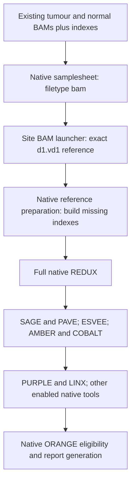

# Native BAM entry with our existing reference

Branch: `codex/native-bam-input`. Site resource policy: `input-v2`.
Upstream source remains nf-core/oncoanalyser3.0.0,
`7c74c87a43749952b38c9a18915947570f0595a0`. This is a site launch profile,
not a fork of its analytical modules or a replacement variant caller.

## Entry and data flow



Native BAM inputs skip DNA FASTQ alignment automatically; REDUX still processes
the BAM and downstream tools receive its native outputs. Do not call a
Parabricks BAM `bam_redux` or bypass REDUX. The stock caller remains SAGE.
Sources: native `docs/usage.md` BAM/REDUX/custom-genome sections,
`lib/Utils.groovy` input mapping, and `modules/local/redux/main.nf`.

Files:

- `workflow/conf/d1_vd1.config` supplies our exact FASTA, FAI and dictionary.
- `workflow/run_bam_oncoanalyser_frontenac.sbatch` is the separate Slurm entry.
- `samplesheets/KQ0205_full_dna_bam_custom.csv` binds the already located
  full-size tumour and matched-normal BAMs. Their `.bam.bai` files are adjacent.
- `workflow/build_input_resources.py --samplesheet` measures those files and
  writes the initial allocation plus evidence. This route requires no FASTQ
  recovery or recovery completion record.

The shared launcher now accepts `ONCO_GENOME`, defaulting to the unchanged
`GRCh38_hmf` FASTQ route. The BAM entry explicitly selects `GRCh38_d1_vd1`,
`--genome_version 38 --genome_type no_alt --force_genome`, and the unmodified
3.0.0 source. HMF tool resources remain the staged3.0.0 GRCh38 bundle. Native
`PREPARE_REFERENCE` builds missing genome-specific indexes in its own work
directories; never substitute the HMF `.img` or GRIDSS index for d1.vd1.

The prepared first comparison sheet is DNA-only. Native optional RNA input
remains available, but existing RNA alignment/reference and annotation
compatibility need separate source-backed treatment before adding that row.
The ongoing full native FASTQ run preparation retains its DNA+RNA scope.

## Initial resources

When no verified read count is supplied, policy input-v2 uses10GiB of measured
compressed input per workload unit. It records `read_pairs: null` and explicitly
labels the bytes proxy; it does not invent a read count. FASTQ lanes aggregate
per sample, repeated source paths fail, and the existing stage resource table
uses the appropriate tumour, normal, paired-DNA or RNA workload.

Heavy read-processing tasks receive64 CPUs for these full-size inputs. Memory
includes per-core and input-volume allowances; walltime includes stage floors.
The final configuration overrides the historical32-core ceiling. This remains
a conservative extrapolation pending full-input execution, not a claim of
validated runtime or identical findings between differently masked references.
Reference indexing retains native tool-specific allocation; it is driven by
the reference rather than patient read volume.

## Review and execution

First compile the native graph with `-preview`; this creates no genomic tasks:

```bash
WIGITS_WORKFLOW_DIR="$PWD/workflow" \
  bash workflow/run_bam_oncoanalyser_frontenac.sbatch \
  KQ0205_bam_entry_preview_20261109 \
  samplesheets/KQ0205_full_dna_bam_custom.csv -preview -ansi-log false
```

A later analytical launch requires a frozen package and a new execution ID.
The following is the entry shape, not a statement that it has been submitted:

```bash
sbatch --account=def-hpcg6049_cpu \
  workflow/run_bam_oncoanalyser_frontenac.sbatch \
  KQ0205_full_bam_custom_comparison \
  samplesheets/KQ0205_full_dna_bam_custom.csv
```

Preserve the native FASTQ baseline. Compare whole-genome analytical outputs
before interpreting masking, HLA or viral differences. Viral decoys are not
automatically a fatal limitation: VIRUSBreakend2.13.2 supports
`--viralreferences`; check actual contig-name coverage before using that option.
No automatic BQSR status is inferred from the label `analysis_ready`.
No custom ORANGE patch, threshold relaxation or fabricated missing input is
part of this entry. Runtime/reference validation and a full comparative run
remain pending until separately recorded.

Current checks and the native preview-finalization limitation are recorded in
[the development evidence](../tests/results/native-bam-input/README.md).
