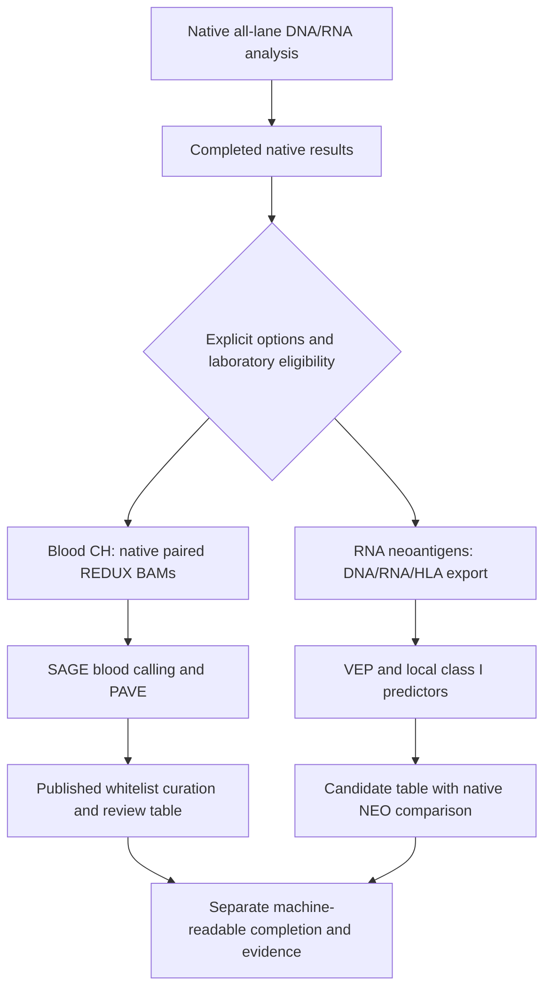

# Optional blood CH and RNA-informed neoantigen execution

Integration candidate on `codex/optional-chip-neo`, from published v0.2.0 and
Claude Science's completed `chip/reporting-layer` at `b618a90`. These features
are independently selected. The scientific caller, whitelist curation and
neoantigen ranking are the completed feature implementations, not newly tuned
rules. Current main/v0.2.0 and issued jobs remain unchanged.



## Select options in the package

Copy [the synthetic configuration example](../samplesheets/optional_extensions.example.json)
to the frozen execution package as `optional_extensions.json`, replacing its
placeholder paths and identities with the actual package/laboratory bindings.
Each case chooses `options.blood_ch` and `options.rna_neoantigens` separately.
Absent options default false. Without this file, `run_full_native.sbatch`
retains its existing native behavior exactly. With the file, it invokes
`OPTIONAL_EXTENSIONS` after successful native analysis; no alignment, REDUX,
SAGE somatic, RNA analysis or ORANGE rerun is introduced.

Eligibility and execution are distinct:

| Option | Eligibility and prerequisites | Output |
|---|---|---|
| `blood_ch` | Bound lab record confirms blood normal; native HMF paired REDUX BAMs/indexes, PURPLE purity and the explicit SAGE/PAVE reference resources | Dedicated blood call VCFs, all-variant curation/review tables and source criteria |
| `rna_neoantigens` | Bound record confirms tumour RNA; matching native DNA/RNA sample headers, SAGE_APPEND RNA support, ISOFOX expression and class-I LILAC typing | Export, local VEP/pVACseq predictions, complete prediction table, review shortlist and native NEO concordance |

`gDNA` or the generic native normal role is never used to infer blood.
RNA availability alone is not evidence of expression. Missing actual RNA
support/quantification produces `MISSING_INPUTS`, not a negative result.
Failed or absent class-I typing produces `NOT_ASSESSED`; no typing is invented.
An export with no selected coding variants records `NO_CANDIDATES` rather than
attempting a predictor with empty input. This coding restriction belongs only
to the existing neoantigen feature; it does not change patient-report selection.

The current feature supports the native masked `GRCh38_hmf` route. Custom-reference
BAM experiments are not implicitly admitted. Every resource/container path and
bind root is explicit in the configuration. No wildcard PAVE selection is used
by the integrated entry. The example names the already tested component versions;
it does not download or install them on another host.

## Execute or resume independently

Within the ordinary full-native package, selection is automatic once that native
workflow succeeds. Existing completed native results can instead be used directly:

```bash
# Load the site's already installed Nextflow and Apptainer first.
export WIGITS_EXTENSIONS_SITE_CONFIG=/path/to/site.config
bash /path/to/pinned/release/workflow/run_optional_extensions.sh \
  /path/to/package/optional_extensions.json /path/to/analysis/extensions
```

The maintained Nextflow entry is `workflow/optional_extensions.nf -entry
OPTIONAL_EXTENSIONS`. It has independent `BLOOD_CH` and `NEO_PREPARE` branches;
`NEO_PREDICT` consumes a successful, eligible export. Tasks run through the
selected site's executor, retain separate cache/work directories, and use
`-resume`. Failures use `errorStrategy 'finish'`, allowing already submitted
tasks to finish before the extension workflow reports failure, as documented
in [Nextflow's process reference](https://docs.seqera.io/nextflow/reference/process/directives/error-strategy).

```text
extensions/
  state/plan.json                 # actual eligibility, selected options and initial resources
  state/status.json               # separate status per case and feature
  logs/trace.tsv                  # process, case tag, scheduler ID, exit, workdir and usage
  work/                          # resumable extension tasks
  results/<case>/
    blood_ch/                    # native blood VCFs and all-variant review tables
    neo_export/                  # source-bound DNA/RNA/HLA export
    rna_neoantigens/              # VEP, pVACseq, shortlist, candidate/concordance tables
```

Each task records its commands, source plan and completion/failure receipt.
The final collector also reads failed tasks through the trace's recorded work
directory, because failed Nextflow outputs are not published. Disabled,
ineligible, missing-input, not-assessed, no-candidate, incomplete, failed and
completed states stay distinct. No status implies scientific review or CHIP
diagnosis. The [trace reference](https://docs.seqera.io/nextflow/reference/config/trace)
defines the recorded fields.

The full-native head additionally writes `state/native_workflow_completed.json`
before selected extensions run. If an extension fails, the head exits nonzero
but retains that native completion receipt; resume the extension entry alone
to avoid confusing a downstream failure with a need to realign. Existing
tracker native/ORANGE feeds are unchanged; the extension status record is a
separate research product and is not yet an Excel-tracker column.

## Input-adjusted resources

The existing DNA and RNA resource policies are unchanged. New CH panel tasks
use8CPU/48GiB and a120minute allowance plus30minutes per100GiB of paired BAMs.
Export uses1CPU/8GiB and30minutes plus30minutes per0.25GiB of the source somatic
VCF. VEP/prediction uses8CPU/32GiB and120minutes plus60minutes per500
selected-variant × class-I-allele combinations. The latter workload comes from
the completed exporter, not complete-library FASTQ size. These are conservative
initial bounds requiring runtime measurement, not validated throughput estimates.
No new BAM scans, FASTQ counting or whole-file hashing are introduced; the
existing exporter retains its small native-result provenance hashes.

## Existing predictor behavior retained

VEP115.2/cache115 merged uses `--use_given_ref`, `Wildtype`, `Frameshift`,
`--tsl` and `--biotype`; both main and single-sample proximal VCFs are annotated
and indexed. pVACtools5.4.0 uses the feature's local class-I MHCflurry,
MHCflurryEL and MHCnuggetsI ensemble with8–11mers. No peptide is sent to an
external predictor and no NetMHC licence is assumed. All epitopes and the native
aggregate are retained alongside the explicit binding/coverage/TSL/top-score
review cascade and the feature's candidate table.

The installed5.4.0 image lacks its packaged default gene list. The integrated
call supplies the existing CGC gene list through `--genes-of-interest-file`,
avoiding that specific missing-default error rather than accepting a failed
prediction. This option marks gene interest; it does not filter variants.
The [official5.4 release notes](https://pvactools.readthedocs.io/en/latest/releases/5_4.html)
describe the option and the subsequent5.4.1 packaging fix. No package is upgraded.
The existing curation/ranking thresholds are retained. PDFs and finalized report
prose are not regenerated, replaced or extended by this integration.

## Verification and remaining deployment work

Offline unit/feature results and the compute-node CLI inspection are recorded in
`tests/results/optional-extensions/README.md`. End-to-end Nextflow/HPC execution
and real-case comparator checks remain pending until this candidate is pushed
and reviewed under the repository's normal release policy. No new source is
selected by active native jobs or transfer queues. Fir additionally needs its
explicit site profile and staged tool/reference assets before owner-operated
execution. Main promotion and a numbered publication are separate from this
source integration.
