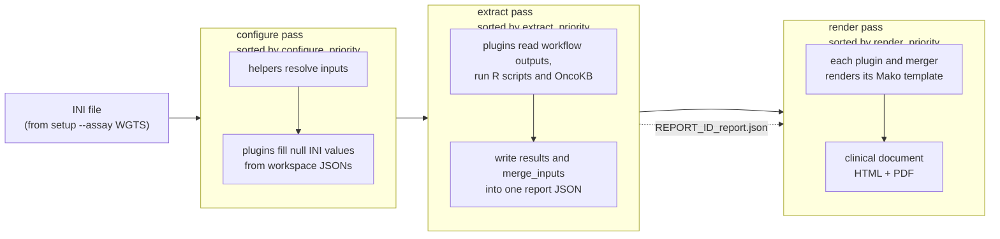
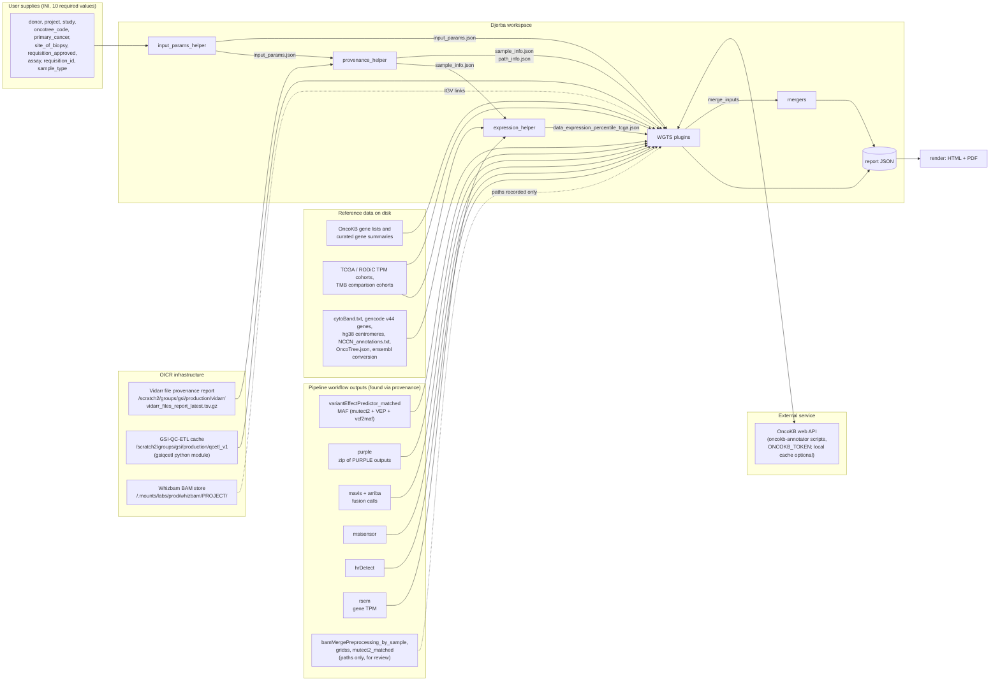
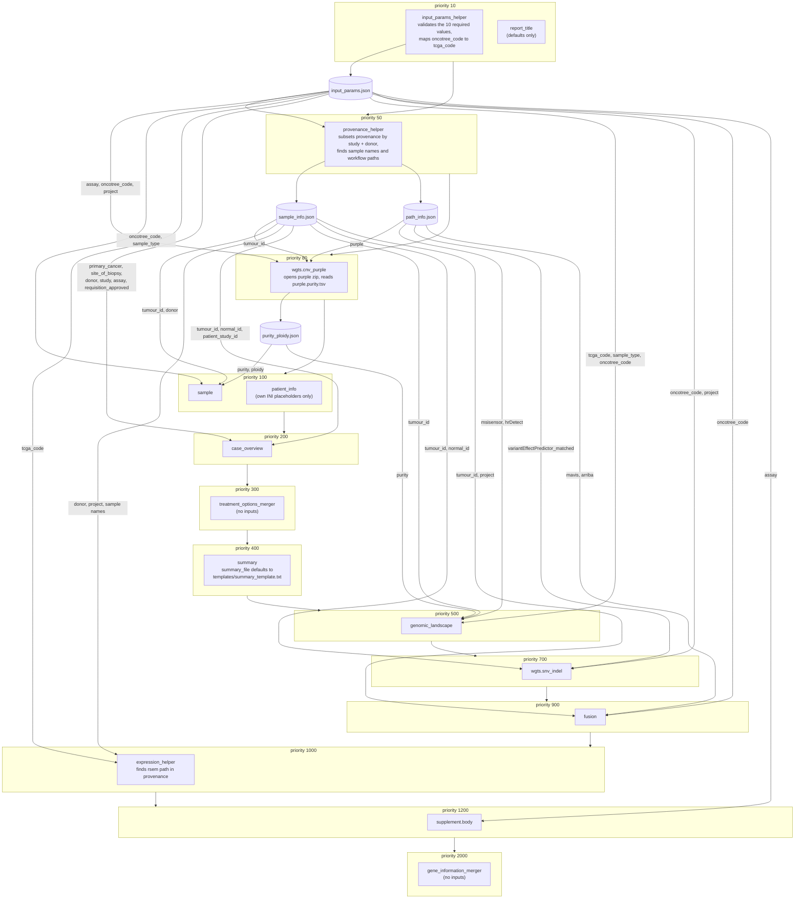
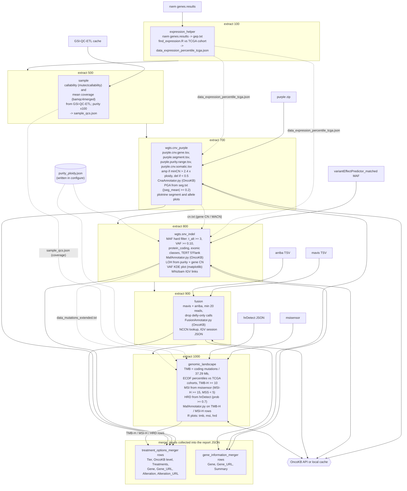

# Djerba WGTS report under default settings: plugins, data sources and data flow

Source read: `oicr-gsi/djerba` at commit `0367bf1` (15 Sep 2026), version **1.13.1**. Paths below are relative to `src/lib/djerba/`. Nothing here depends on OICR services; it is what the code does when `djerba.py setup --assay WGTS` is used and no INI value is overridden.

---

## 1. What a "default WGTS run" means

`core/main.py:503` hard-codes the component list for each assay. For WGTS:

| Kind | Component | Section it produces |
|---|---|---|
| core | `core` | report id, author, document config (no visible section) |
| helper | `input_params_helper` | none (writes `input_params.json`) |
| helper | `provenance_helper` | none (writes `sample_info.json`, `path_info.json`) |
| plugin | `report_title` | title banner |
| plugin | `patient_info` | patient and physician box |
| merger | `treatment_options_merger` | Approved / Investigational / Prognostic tables |
| plugin | `case_overview` | case overview |
| plugin | `summary` | results summary text |
| plugin | `sample` | sample information and QC |
| plugin | `genomic_landscape` | TMB, MSI, HRD |
| helper | `expression_helper` | none (writes `data_expression_percentile_tcga.json`) |
| plugin | `wgts.snv_indel` | SNV and indel table, VAF plot |
| plugin | `wgts.cnv_purple` | copy number table and PURPLE plots |
| plugin | `fusion` | fusions and structural variants |
| merger | `gene_information_merger` | gene descriptions |
| plugin | `supplement.body` | methods, disclaimer, sign-off, definitions |

WGS is the same list minus `expression_helper` and `fusion`. TAR and PWGS use their own plugin families.

A plugin is one report section. A helper gathers data for other components and renders nothing. A merger collects rows that several plugins emit and renders them once.

---

## 2. Three passes, three separate priority orders

Djerba runs every component three times, in three passes. Each pass sorts components by its own priority key (`core/main.py:163`, `:168`, `:209`), so the order in which data is gathered is not the order in which sections appear on the page.

Default priorities as shipped in each component's code:

| Component | configure | extract | render | Where set |
|---|---|---|---|---|
| `input_params_helper` | 10 | 10 | — | `helpers/input_params_helper/helper.py:37` |
| `report_title` | 10 | 10 | **10** | `plugins/report_title/plugin.py:9` |
| `provenance_helper` | 50 | 50 | — | `helpers/provenance_helper/helper.py:33` |
| `wgts.cnv_purple` | 80 | 700 | **800** | `plugins/wgts/cnv_purple/plugin.py:21-23` |
| `patient_info` | 100 | 100 | **30** | `plugins/patient_info/plugin.py:13,93` |
| `sample` | 100 | 500 | **500** | `plugins/sample/plugin.py:69-71` |
| `case_overview` | 200 | 200 | **40** | `plugins/case_overview/plugin.py:21,143` |
| `treatment_options_merger` | 300 | — | **50** | `mergers/treatment_options_merger/merger.py:33,110` |
| `summary` | 400 | 400 | **400** | `plugins/summary/plugin.py:16` |
| `genomic_landscape` | 500 | 1000 | **500** | `plugins/genomic_landscape/plugin.py:62-64` |
| `expression_helper` | 1000 (helper base default) | 100 | — | `helpers/expression_helper/helper.py:165`, `helpers/base.py:27` |
| `wgts.snv_indel` | 700 | 800 | **700** | `plugins/wgts/snv_indel/plugin.py:23-25` |
| `fusion` | 900 | 900 | **900** | `plugins/fusion/plugin.py:25` |
| `supplement.body` | 1200 | 1200 | **1200** | `plugins/supplement/body/plugin.py:15` |
| `gene_information_merger` | 2000 | — | **2000** | `mergers/gene_information_merger/merger.py:15` |

Components that set no value for a pass inherit the base default of 1000 (`plugins/base.py:25-27`, `helpers/base.py:27-28`); `expression_helper` is the one WGTS component where that matters, since it sets only its extract priority.

Any of these can be overridden by writing `configure_priority = N`, `extract_priority = N` or `render_priority = N` under the component's INI section. A default run never asks you to.

---

## 3. Big picture: where the data comes from

Two points that follow from this picture:

- **Only ten values are typed by a human.** Everything else is discovered. `provenance_helper` resolves donor + project + assay against the Vidarr provenance report to find sample names, tumour/normal IDs and the path of every workflow output; `sample` reads callability and coverage from the GSI-QC-ETL cache. Outside OICR, `input_params.json`, `sample_info.json` and `path_info.json` are what you would have to write by hand (or replace the two helpers).
- **OncoKB is the only network call**, and it happens in four plugins (snv_indel, cnv_purple, fusion, genomic_landscape) through `util/oncokb/annotator.py`, which shells out to `MafAnnotator.py`, `CnaAnnotator.py` and `FusionAnnotator.py` with the token from `ONCOKB_TOKEN`. Every one of those plugins has `apply cache` / `update cache` INI flags that answer from a local cache instead.

---

## 4. Configure pass: resolving every INI value

Sorted by `configure_priority`. Arrows show which workspace JSON each component reads to fill in its null INI values (`update_wrapper_if_null`, `read_maybe_input_params`, `read_json`).

Why `cnv_purple` configures at 80, far ahead of its render slot at 800: its configure step is the one that opens the PURPLE zip and writes `purity_ploidy.json` (`plugins/wgts/cnv_purple/plugin.py:43-46`). Three later plugins need purity before they can decide anything, so the copy-number plugin is forced to the front of the queue.

`report_id` is generated by core from `requisition_id` + `report_version` (default `v1`) if `input_params.json` exists, otherwise `OICR-CGI-<uuid>` (`core/configure.py:343-357`).

---

## 5. Extract pass: workflow outputs in, report JSON out

Sorted by `extract_priority`. This is the pass that touches the pipeline outputs. Solid arrows are files read; dashed arrows are files one plugin writes into the workspace for another plugin to read.

The dependency chain explains the odd numbers:

1. `expression_helper` (100) must finish before `snv_indel` and `cnv_purple` so the Expression column can be filled.
2. `sample` (500) writes `sample_qcs.json`; `genomic_landscape` reads coverage from it to decide whether HRD can be reported (coverage ≤ 115 and purity ≥ 0.5, or ≥ 0.3 for non-FFPE; MSI needs purity ≥ 0.5).
3. `cnv_purple` (700) writes `cn.txt`; `snv_indel` (800) uses it with purity to flag LOH.
4. `snv_indel` writes `data_mutations_extended.txt`; `genomic_landscape` (1000) counts its rows for TMB, which is why the biomarker plugin extracts last even though it renders mid-page.

Plugins that do no extraction work beyond copying INI values: `report_title`, `patient_info`, `case_overview`, `summary` (reads one text file), `supplement.body` (reads `component_info.json` written by core and the core `author`).

---

## 6. Render pass: the page order

Sorted by `render_priority`. Each box is one section of the clinical document, top to bottom as it appears on the page. The two mergers render rows that were collected from the plugins named inside their box (the collection itself is drawn in the extract diagram above).

```mermaid
flowchart TB
    R10["10 - report_title<br/>title banner (clinical or failed)"]
    R30["30 - patient_info<br/>patient name, DOB, sex, physician, hospital<br/>(placeholders unless set in INI)"]
    R40["40 - case_overview<br/>assay, primary cancer, biopsy site, donor, study,<br/>patient study id, tumour id, normal id,<br/>report id, requisition approved date"]
    R50["50 - treatment_options_merger<br/>rows from snv_indel, cnv_purple, fusion, genomic_landscape<br/>Approved (levels 1, 2, R1)<br/>Investigational (3A, 3B, 4, R2)<br/>Prognostic (P)<br/>sorted by OncoKB level, then alteration, then gene"]
    R400["400 - summary<br/>free text from summary_file"]
    R500a["500 - sample<br/>OncoTree code, sample type, cancer cell content,<br/>ploidy, callability, mean coverage"]
    R500b["500 - genomic_landscape<br/>TMB per Mb and percentiles, MSI, HRD,<br/>three plots, NA with reason when not reportable"]
    R700["700 - wgts.snv_indel<br/>counts, VAF plot, table: Gene, Chr, Protein, Type,<br/>VAF, Depth, Expr, LOH, OncoKB<br/>rows = oncogenic with reportable level"]
    R800["800 - wgts.cnv_purple<br/>PGA, PURPLE segment plot, table:<br/>Gene, Chr, Expr, Alteration, OncoKB"]
    R900["900 - fusion<br/>counts, table: Fusion, Rearrangement,<br/>CDS frame, Mutation effect, Actionability"]
    R1200["1200 - supplement.body<br/>assay description with fixed tool versions,<br/>disclaimer, sign-off block, OncoKB level<br/>and metric definitions"]
    R2000["2000 - gene_information_merger<br/>genes from snv_indel, cnv_purple, fusion<br/>OncoKB summary for every reported gene,<br/>deduplicated and sorted by gene URL"]

    R10 --> R30 --> R40 --> R50 --> R400 --> R500a --> R500b --> R700 --> R800 --> R900 --> R1200 --> R2000
```

Two things about the ordering as shipped:

- `sample` and `genomic_landscape` share render priority 500. The sort is stable (`core/render.py:52`) and it runs over the plugin keys of the report JSON, which were inserted in extract order (`core/main.py:170-180`). `sample` extracts at 500 and `genomic_landscape` at 1000, so sample information comes first on the page.
- The design intent reads directly from the numbers: identity and requisition first (10–40), the actionable answer before any evidence (50), then a written summary (400), QC and biomarkers (500), per-variant evidence in the order SNV, CNV, fusion (700–900), methods and sign-off (1200), gene glossary last (2000). Treatment options and gene descriptions are mergers, so they render at a fixed slot even though their rows come from four and three plugins respectively.

Every production component carries `attributes = clinical`, so a default run emits one document, `<report_id>_report.clinical.html` (and `.pdf` with `--pdf`), with the clinical header and footer from `core/html/`. A `research` attribute would route a section into a second `*_report.research.html` document instead.

---

## 7. Per-plugin data inventory

| Plugin | Workflow outputs read | Workspace files read | Reference data | External | Workspace files written | Feeds merger |
|---|---|---|---|---|---|---|
| `report_title` | — | — | — | — | — | — |
| `patient_info` | — | — | — | — | — | — |
| `case_overview` | — | `input_params.json`, `sample_info.json` | `util/assays.py` (assay descriptions) | — | — | — |
| `summary` | — | `summary_file` (text) | bundled `summary_template.txt` | — | `results_summary.txt` | — |
| `sample` | — | `input_params.json`, `sample_info.json`, `purity_ploidy.json` | GSI-QC-ETL cache (`mutectcallability`, `bamqc4merged`) | — | `sample_qcs.json` | — |
| `genomic_landscape` | `msisensor`, `hrDetect` | `purity_ploidy.json`, `sample_qcs.json`, `data_mutations_extended.txt` | `tmbcomp-tcga.txt`, `tmbcomp-externaldata.txt`, `OncoTree.json`, `NCCN_annotations.txt` | OncoKB (MafAnnotator on biomarker MAF) | `genomic_biomarkers.maf`, `_annotated.maf`, `msi.txt`, `hrd.tmp.txt`, `tmb.svg`, `msi.svg`, HRD svg | treatment_options (TMB-H, MSI-H, HRD prognostic) |
| `wgts.snv_indel` | `variantEffectPredictor_matched` MAF | `purity_ploidy.json`, `cn.txt`, `data_expression_percentile_tcga.json` | `cytoBand.txt`, `20251008-allCuratedGenes.tsv`, OncoKB gene list | OncoKB (MafAnnotator) | `filtered_maf.tsv`, `data_mutations_extended.txt`, `data_mutations_extended_oncogenic.txt`, `loh.txt`, `vaf_plot.svg`, `whizbam_*.txt` | both |
| `wgts.cnv_purple` | `purple` zip | `data_expression_percentile_tcga.json`, `path_info.json` (BAM / gridss / mutect2 paths for `purple.alternate.json`) | `20251008-oncoKBcancerGeneList.tsv`, `gencode_v44_hg38_genes.bed`, `hg38_centromeres.txt` | OncoKB (CnaAnnotator) | `purity_ploidy.json` (configure), `purple.data_CNA.txt`, `data_CNA_oncoKBgenes_nonDiploid*.txt`, `purple.segments.txt`, `purple.arm_level_calls.txt`, `seg.txt`, `cn.txt`, `purple_copy_states.json`, `purple.alternate.json`, segment and allele SVGs | both |
| `fusion` | `mavis`, `arriba` | `input_params.json`, `sample_info.json` | `NCCN_annotations.txt`; Whizbam BAMs under `/.mounts/labs/prod/whizbam/<project>/RNASEQ/` | OncoKB (FusionAnnotator) | `data_fusions.txt`, `data_fusions_oncokb.txt`, `data_fusions_NCCN.txt`, `_annotated.txt`, per-fusion IGV JSON, `fusion_blurb_urls.tsv` | both |
| `supplement.body` | — | `component_info.json` (from core) | `resources/*.html` static text, `versioning.py` tool versions | — | — | — |
| `expression_helper` | `rsem` genes.results | `sample_info.json`, `input_params.json`, `provenance_subset.tsv.gz` | `gep_reference.txt.gz`, `ensembl_conversion_hg38_v*.txt`, RODiC TCGA TPM data | — | `gep.txt`, `data_expression_percentile_tcga.txt` / `.json` | — |
| `provenance_helper` | — | `input_params.json` | Vidarr provenance report | — | `provenance_subset.tsv.gz`, `sample_info.json`, `path_info.json` | — |
| `input_params_helper` | — | — | OncoTree-to-TCGA map | — | `input_params.json` | — |

`path_info.json` keys the helper fills for WGTS, in the order the code lists them (`helpers/provenance_helper/helper.py:214-247`, names in `util/provenance_reader.py:26-45`): `arriba`, `bamMergePreprocessing_by_sample` (four BAM/index paths), `delly_matched`, `gridss`, `hrDetect`, `mavis`, `msisensor`, `mutect2_matched`, `purple`, `rsem`, `sequenza_by_tumor_group`, `star_call_ready`, `starfusion`, `variantEffectPredictor_matched`, `virusbreakend`, `immunedeconv`, `t1k`. Of these, the default WGTS plugins actually consume `variantEffectPredictor_matched`, `purple`, `mavis`, `arriba`, `msisensor`, `hrDetect`, `rsem`, and record (without reading) `bamMergePreprocessing_by_sample`, `gridss` and `mutect2_matched`. The rest are discovered for other plugins (delly, sequenza, starfusion, virus, immune, HLA) that are not in the WGTS default.

---

## 8. Filters that shape what reaches the page

These are hard-coded in the plugins, not INI-tunable, except where noted.

| Stage | Rule | Where |
|---|---|---|
| SNV/indel hard filter | `t_alt_count ≥ 3`, VAF ≥ 0.10, gnomAD AF < 0.001 (unmatched only), `protein_coding`, exonic consequence classes, TERT accepted only as 5'Flank hotspot | `plugins/wgts/snv_indel/tools.py:373-411` |
| SNV/indel report rows | OncoKB oncogenic or likely oncogenic **and** a reportable level, sorted by level | `tools.py:262-315` |
| CNV call | amplification if `minCopyNumber > 2.4 × ploidy`, deletion if `< 0.5` | `purple_tools.py:508-527` |
| CNV report rows | OncoKB-annotated non-diploid genes with reportable level | `legacy_tools.py` |
| Fusion | ≥ 20 supporting reads (`minimum fusion reads`, INI-tunable), delly-only calls dropped | `plugins/fusion/preprocess.py` |
| TMB | coding mutations ÷ 37.285536 Mb; TMB-H at ≥ 10 | `plugins/genomic_landscape/tmb.py:46,60` |
| MSI | MSI-H ≥ 15, MSS < 5, reportable only if purity ≥ 0.5 | `msi.py`, `plugin.py:165-192` |
| HRD | hrDetect probability ≥ 0.7; reportable if coverage ≤ 115 and purity ≥ 0.5 (≥ 0.3 if not FFPE) | `hrd.py`, `plugin.py:36-39` |
| QC gate | callability < 75% raises an error unless `ignore_warning = True` | `plugins/sample/plugin.py:163-189` |
| Treatment tiers | 1, 2, R1 → Approved; 3A, 3B, 4, R2 → Investigational; P → Prognostic | `util/oncokb/tools.py:142-151` |

---

## 9. Running this outside OICR

The default pipeline assumes three things that do not exist elsewhere: the Vidarr provenance report, the GSI-QC-ETL cache and the `/.mounts/labs/...` reference tree. The least invasive path is to keep every plugin and replace the two discovery helpers:

1. Write `input_params.json`, `sample_info.json` and `path_info.json` by hand in the workspace (the keys are listed above and in the helpers' source).
2. Set `callability` and `mean_coverage` directly under `[sample]` in the INI so the QC-ETL lookup is skipped (`sample` only queries the cache when those values are null, and skips entirely when `gsiqcetl` is not importable).
3. Point the `oncokb cache` INI value of each of the four OncoKB plugins at a local directory and set `apply cache = True` if variants must not leave the site; fill the cache once with `update cache = True`.
4. Supply the reference files the plugins expect (`cytoBand.txt`, `NCCN_annotations.txt`, OncoKB gene list and curated summaries, TCGA TMB cohorts, gencode v44 BED, RODiC TPM data for the expression helper) under `DJERBA_RUN_DIR`.

The plugin set, the three priority orders and the table columns then come out exactly as a production report.
