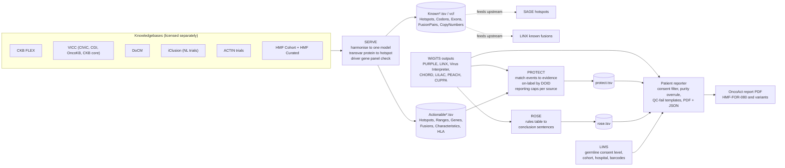

# Hartwig's clinical layer: SERVE, PROTECT, ROSE and the patient reporter

What sits between the ORANGE JSON and the signed OncoAct report, as far as public material shows. This is the layer `wigits-clinical` sets out to rebuild in the open.

## Where the evidence comes from

The four components were part of `hartwigmedical/hmftools` until late 2022 and were then moved into `hartwigmedical/oncoact`, which is not publicly readable. Two kinds of public evidence remain.

1. **Source code in hmftools history.** Tag `rose-v1.3` (11 Oct 2022) still contains `protect/`, `rose/`, `serve/` and `patient-reporter/`. The hmftools README today lists PROTECT 2.3 and ROSE 1.3 as current, so that snapshot is close to what runs for those two. The patient reporter has had no public release since, so treat its details as a 2022 baseline.
2. **Regulatory and product documents published by Hartwig.** The IVDR user manual (HMF-IVDD-275 v1.0), an example patient report (template HMF-FOR-080, COLO829 demo data), and the OncoAct release notes that ship inside `hartwigmedical/pipeline5` under `ivdr/`.

Everything below is taken from those sources. Where something is inferred rather than read, it says so.

## How the pieces fit

The shape that matters for the rebuild. The knowledgebase step runs **before** the pipeline as well as after it. SERVE's known-event files are what SAGE and LINX use as hotspot and known-fusion lists, so the callers already know which positions are clinically relevant. PROTECT then matches at the end. In an OncoKB-style design the knowledge base is consulted once, after calling.

## SERVE

Search External Resources for Variant Evidence. Ingests knowledgebases and writes one harmonised model.

**Inputs supported in the 2022 snapshot.** CKB FLEX (full), VICC (which carries CIViC, CGI, OncoKB and CKB core), DoCM, iClusion, ACTIN, HMF Cohort (recurrent somatic mutations from the Hartwig database) and HMF Curated (hand-curated drivers). SERVE supports ingestion only; the data and its licences are the user's problem.

**What it does to each entry.**

- Gene check against Hartwig's exome definition; unknown genes are dropped (fusion partners such as IG genes are allowed).
- Driver-panel consistency check with a per-source policy of FILTER, IGNORE or WARN_ONLY (for example "inactivation" evidence on a gene the panel calls an oncogene).
- Protein annotation to genomic hotspots with transvar. Transcript choice is the knowledgebase's transcript if given, else the Hartwig canonical transcript, else a consistently chosen alternative. SNV/MNV produce every codon spelling of the new amino acid; DUP and inframe DEL one hotspot (plus left-aligned alternatives for DEL); inframe INS all spellings for one amino acid, one representative for longer inserts; frameshifts all single-base and double-base edits in the codon that are not synonymous. INDELs over 50 bases and anything spanning an exon boundary are skipped.
- Curation and harmonisation per knowledgebase, and curated treatment-approach (drug class) labels.
- Reference genome handling for both GRCh37 and GRCh38.

**Output model.** Treatment (drug or trial name), relevant and curated treatment approaches, cancer type as a DOID, blacklisted child DOIDs, evidence level A to D, direction (RESPONSIVE, PREDICTED_RESPONSIVE, NO_BENEFIT, RESISTANT, PREDICTED_RESISTANT), source URLs and evidence URLs. Written as `ActionableHotspots`, `ActionableRanges` (codon and exon), `ActionableGenes` (activation, inactivation, amplification, deletion, any mutation), `ActionableFusions`, `ActionableCharacteristics` (MSI, TML, TMB, HRD, viral presence, signatures), `ActionableHLA`, plus `EventInterpretation.tsv` for traceability. Alongside it the known-event files, `KnownHotspots`, `KnownCodons`, `KnownExons`, `KnownFusionPairs`, `KnownCopyNumbers`.

## PROTECT

Personalized Report On Treatment and Eligibility for Clinical Trials. Matches SERVE evidence against the genomic events of one sample.

**Inputs.** PURPLE somatic and germline driver catalogs and variants, PURPLE gene copy number, LINX fusions and driver catalog (homozygous disruptions), Virus Interpreter, CHORD, LILAC, tumour DOIDs, reference genome version, and the SERVE actionability directory.

**Matching per event class.**

| Event | Rule |
|---|---|
| hotspot | exact match on the variant always applies |
| codon or exon range | applies if the variant is of the mutation type the rule names and the gene's combined driver likelihood is above 0.8 |
| gene level (activation, inactivation, any) | applies if the gene's combined driver likelihood is above 0.8 and the impact is coding or splice |
| amplification, deletion | PURPLE classified the gene as amplified or deleted; a deletion also satisfies "inactivation" |
| homozygous disruption | LINX homozygous disruption satisfies inactivation, deletion or any-mutation evidence |
| fusion | exact pair must match the pair and optional exon range; promiscuous-gene evidence applies if a reported fusion has that gene on the 5' or 3' side as the rule names |
| viral presence | Virus Interpreter reports the virus with HIGH driver likelihood; HPV evidence matches any HPV type |
| signatures and characteristics | compared against the comparator and cutoff in the rule, else the producing tool's own call |
| HLA | germline allele match at two-digit resolution |
| wild-type | gene is in the panel and has no reported variant, copy number, fusion or disruption; currently always marked not reportable |

Germline and somatic variants are treated identically for matching.

**On-label.** Decided by DOID ancestry only. Evidence for "solid tumour" is on-label for a colorectal sample because colorectal is a descendant. A sample may carry several DOIDs; one match suffices. If no DOIDs are supplied, every piece of evidence is off-label, including pan-cancer evidence.

**Consolidation and reporting caps.**

1. Identical evidence from several sources is merged into one row listing all sources.
2. Evidence on events that are not reportable is kept in the TSV but marked `reported = false`.
3. Per-source caps. CKB up to level C, or up to B when the direction is predicted. VICC, ACTIN and iClusion up to B. Every other source A only.
4. Per gene, event, treatment and direction, only the highest on-label level is reported; off-label evidence only when there is no on-label evidence or it is a higher level.
5. Clinical trials are reported only when on-label.
6. Never reported regardless of level. Evidence based on TP53, and evidence for non-specific chemotherapy, aspirin or steroids.

**Output.** One TSV with gene, transcript, isCanonical, event, eventIsHighDriver, germline, reported, treatment, onLabel, level, direction, and a nested list of sources (name, sourceEvent, sourceUrls, evidenceType, rangeRank, evidenceUrls).

## ROSE

Relevant Oncogenic Summary of Eligibility. Produces the sentences in the report's "Summary of clinical relevance" box. It is a lookup table, not an algorithm.

**Rules table.** Each row has a match (gene or signature), a type of alteration, a condition, and a conclusion sentence.

- Alteration types for events. AMPLIFICATION, LOSS, INACTIVATION, FUSION, INTERNAL_DELETION (EXON_DEL_DUP fusions), KINASE_DOMAIN_DUPLICATION (EGFR exon 25-26 to 14-18), POSITIVE (a signature call), EXTRACELLULAR_DOMAIN_MUTATION and RESISTANCE_MUTATION (both listed as not yet interpreted).
- Conditions. ONLY_HIGH (only when the event is a high driver), ALWAYS, ALWAYS_NO_ACTIONABLE (mention the event even though nothing is actionable), OTHER.
- Alteration types for boilerplate. PURITY (below 20 percent), PURITY_UNRELIABLE, FINDINGS, GERMLINE (variant also present in germline), CUPPA (prediction at or above 80 percent), CUPPA_INCONCLUSIVE, NO_ONCOGENIC, NO_ACTIONABLE, NO_HRD_CAUSE (HRD signature without a supporting event), NO_MSI_HRD_PROFILE, NOT_BIALLELIC (TSG variant with an intact allele).

**Matching.** Oncogene variants map to ACTIVATING_MUTATION and only match when high driver. TSG variants map to INACTIVATION, match when high driver under ONLY_HIGH, and the biallelic status is checked so a surviving allele can be flagged. Amplification to AMPLIFICATION, deletion to LOSS, homozygous disruption to INACTIVATION, fusions by LINX type. Signatures. CHORD at or above 0.5 with HR-deficient status, MSI at or above 4, TML at or above 140, TMB at or above 10.

**Output.** One TSV with a single `conclusion` field holding the sentences, newline separated.

The actual rules table was never in the public repo; only its schema and the README examples ("BRCA2 inactivation, potential benefit from PARP inhibitors") are known.

## Patient reporter

Builds the PDF and a JSON copy of the report. Takes roughly fifty command-line arguments in the 2022 snapshot.

**Inputs.** Tumour and reference sample ids and barcodes, a LIMS directory, PURPLE purity, QC, driver catalogs (somatic and germline), somatic and germline VCFs, somatic copy number and circos plot, LINX fusions, breakends, SVs and driver catalog, CHORD prediction, CUPPA result and plot, annotated virus TSV, LILAC result and QC, PEACH genotypes, the PROTECT TSV, optionally the ROSE TSV, a germline reporting TSV, a sample summary TSV and special-remark TSV, known fusion file, primary tumour TSV, cohort config, logos, signature image, UDI-DI, pipeline version file and expected version, and the QC-fail switch with its reason.

**Report chapters, fixed order.** Summary; clinical evidence on-label; clinical evidence off-label; genomic alterations; tumour characteristics; circos; explanation; details and disclaimers. The published example report has exactly this layout across thirteen pages.

**Decisions it makes that are not in ORANGE.**

- *Germline consent.* LIMS supplies a reporting level per sample. REPORT_WITH_NOTIFICATION, REPORT_WITHOUT_NOTIFICATION, NO_REPORTING. A per-gene table then says whether a germline variant triggers notification. ALWAYS, NEVER, ONLY_GERMLINE_HOM (homozygous, or a second independent hit in the same gene), ONLY_SPECIFIC_VARIANT (a named protein change). Germline evidence from PROTECT is dropped when the level is NO_REPORTING. The public example report shows germline as a placeholder released only on a clinical geneticist's request.
- *Reliable purity.* Defined as PURPLE fit method not equal to NO_TUMOR. When purity is unreliable, the report is still produced but copy number, allele copy number, minor allele copy number and biallelic status on variants are blanked, arm-level copy numbers are dropped, and HLA tumour copies are blanked. Below 20 percent purity a separate template with a low-sensitivity disclaimer is used.
- *QC-fail reports.* Separate chapter sets per reason. Technical failure, insufficient DNA, insufficient tumour cells after shallow sequencing, insufficient tumour cells after deep sequencing, and sufficient tumour cells but a failed QC check. A pharmacogenetics page is kept in some of the fail variants.
- *Evidence tables.* On-label and off-label are separate chapters; within each, rows are grouped per treatment, sorted by level, and a "predicted" marker is shown after the level when the direction is predicted. Trials are a separate table from treatments.
- *Panel reports.* A separate three-chapter layout exists for targeted panel runs.

## What the regulatory documents add

From the OncoAct user manual and the example report.

- Intended use. In vitro diagnostic software to facilitate and support diagnosis and clinical decision making, for registered clinicians only.
- Sample requirements. Fresh or fresh-frozen tumour, at least 20 percent tumour cells, at least 85 percent Q30, under 30 percent exclusion after mapping, blood reference required.
- Analytical claims. SNV and indel sensitivity 99.2 percent and specificity 95.8 percent; SV sensitivity 94.2 percent; fusions 93 and 95; MSI 100 and 97; viral insertion 100; DPYD 100; TMB R squared 0.98 against panels; tissue of origin 96.1 percent accurate when conclusive, conclusive in 75.6 percent of cases.
- Clinical claim. Diagnostic sensitivity 97.95 percent and PPV 99.7 percent in the WIDE study, samples above 20 percent tumour cells.
- Evidence levels on the report. A, FDA approved or guideline; B, late clinical trial; C, early clinical trial; D, case report or preclinical, not reported. Response marked as responsive or resistant, with a P suffix for predicted. CKB content is displayed under VICC attribution for licensing reasons. Trials from iClusion, with DRUP eligibility noted.
- Report templates. HMF-FOR-080 standard; HMF-FOR-209 low-sensitivity disclaimer for 10 to 20 percent purity; HMF-FOR-100 insufficient tumour cells; HMF-FOR-082 insufficient DNA; HMF-FOR-083 sufficient tumour cells but QC failure; HMF-FOR-102 technical failure.
- Versioning. OncoAct carries its own version separate from WiGiTS. Release 5.22 bundled PROTECT 1.3, PURPLE 2.54, SAGE 2.8, LINX 1.15, CUPPA 1.4, PEACH 1.0. The example report cites pipeline 5.31.
- Sign-off. Generated by an IT employee, checked by a clinical molecular biologist, signed by the foundation's director. Accredited to ISO/IEC 17025:2017.

## What is not known

- Anything in the patient reporter after October 2022, including whether it now reads the ORANGE JSON (the `algo/orange` package in the snapshot suggests that migration had started).
- The current SERVE source mix and licences in production.
- The contents of ROSE's rules table, the germline reporting gene table, and the LIMS cohort configuration.
- How PROTECT handles the OncoAct targeted panel product.
- The report JSON schema the reporter writes alongside the PDF.
