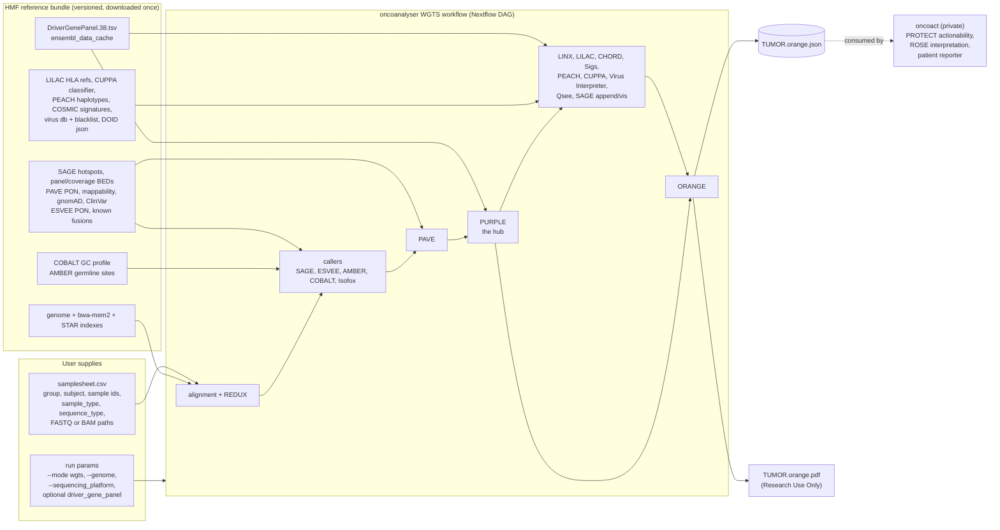
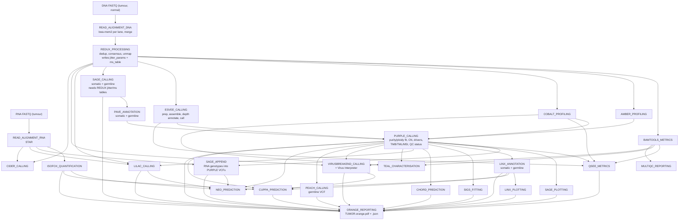
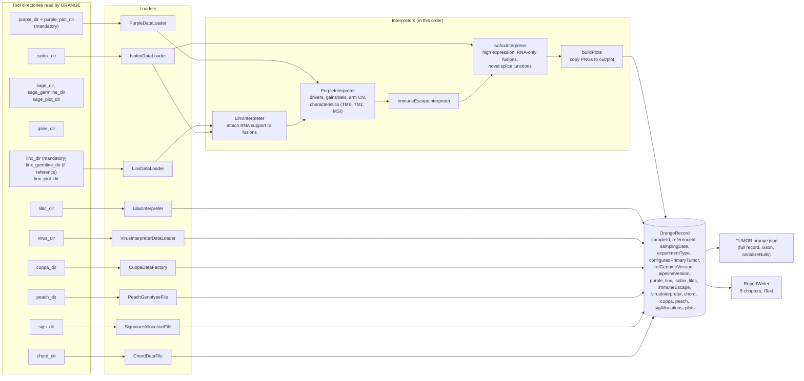
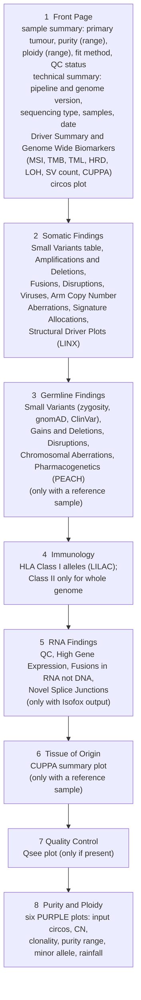

# Hartwig WiGiTS WGTS pipeline under default settings: tools, data sources, data flow and the ORANGE report

Companion to `djerba_wgts_dataflow.md`. Same question, Hartwig's answer: what runs by default, in what order, what each tool reads and writes, and how the final report is assembled.

Sources read:

- `hartwigmedical/hmftools` at commit `6531166` (14 Oct 2026): the tools, plus the `orange` and `orange-datamodel` modules. Paths starting `orange/` are relative to that repo.
- `nf-core/oncoanalyser` at commit `1fc3e64` (8 Oct 2026, release 3.0.0): the orchestrator Hartwig now recommends for WiGiTS (`hmftools/README.md:8`). Paths starting `workflows/`, `lib/`, `modules/` are relative to that repo.
- `hartwigmedical/pipeline5` at commit `0ea4950` (Sep 2025): Hartwig's own GCP orchestrator, used to confirm stage dependencies. It is DNA-only and lags the tool versions in hmftools, so oncoanalyser is treated as the default here.

Three framing facts, because they change how to read everything below.

1. **There is no plugin layer.** In Djerba, the report is assembled from report-section plugins that each wrap a workflow output. In WiGiTS, the tools themselves carry the reporting logic (PURPLE's driver catalog, LINX's `reported` flag on fusions and breakends, Isofox's `reportedStatus`), and one tool, ORANGE, reads everything and lays it out. ORANGE does not re-score anything.
2. **Order is a data-dependency DAG, not a priority number.** oncoanalyser is Nextflow, so a stage starts when the channels it consumes have values. pipeline5 hand-codes the same dependencies as Java futures. The only "ordering" a user can control is which stages are switched on.
3. **The clinical layer is not public.** ORANGE's PDF is a research summary (it prints "Research Use Only" when oncoanalyser runs it, `modules/local/orange/main.nf:128`). Hartwig's clinical report, actionability matching (PROTECT), clinical interpretation (ROSE) and the patient reporter live in `hartwigmedical/oncoact`, which is not publicly cloneable. The counterpart of Djerba's OncoKB-tiered treatment tables is therefore described here only as far as the public code shows the hand-off.

---

## 1. What a "default WGTS run" means

`nextflow run nf-core/oncoanalyser --mode wgts --genome GRCh38_hmf --input samplesheet.csv --outdir out/`

`lib/Processes.groovy:8-36` builds the stage set: every value of `Constants.Process` (`lib/Constants.groovy:65-91`) minus `DEFAULT_EXCLUDED_PROCESSES`, which is currently empty (`:94`), plus or minus `--processes_include` / `--processes_exclude`. So by default **every tool runs**, and `workflows/wgts.nf` further gates each one on what the samplesheet contains (tumour only, tumour-normal, RNA present).

| Stage (`Constants.Process`) | Tool | hmftools version (README, Oct 2026) | What it contributes |
|---|---|---|---|
| `ALIGNMENT` | bwa-mem2 (DNA), STAR (RNA) | external | BAMs from FASTQ |
| `REDUX` | REDUX | 2.0 | duplicate marking, consensus, unmapping, jitter and MS tables |
| `BAMTOOLS` | BamTools | 1.6.1 | coverage, fragment length, flag counts |
| `ISOFOX` | Isofox | 2.0 | RNA TPM, fusions, novel splice junctions |
| `AMBER` | AMBER | 4.3 | tumour BAF at germline het sites |
| `COBALT` | COBALT | 3.0 | read-depth ratios |
| `ESVEE` | ESVEE | 2.0 | SV calling (prep, assembly, depth annotation, caller) |
| `SAGE` | SAGE | 5.0 | somatic and germline point mutations |
| `PAVE` | PAVE | 1.9 | transcript impact, population frequency, ClinVar, PON |
| `PURPLE` | PURPLE | 4.4 | purity, ploidy, CN, driver catalog, TMB/TML/MSI, QC |
| `QSEE` | Qsee | 1.0 | QC plot |
| `SAGE_APPEND` | SAGE append | 5.0 | RNA genotype column added to PURPLE VCFs (RNA only) |
| `SAGE_VISUALISER` | SAGE vis | 5.0 | per-variant HTML plots |
| `LINX` | LINX | 2.3 | SV clustering, chaining, fusions, disruptions, plots |
| `CIDER` | CIDER | 1.2 | TCR/BCR V(D)J (not read by ORANGE) |
| `SIGS` | Sigs | — | COSMIC signature fit |
| `CHORD` | CHORD | 2.2 | HRD prediction |
| `LILAC` | LILAC | 2.0 | HLA typing |
| `TEAL` | TEAL | 1.4 | telomere length (not read by ORANGE) |
| `VIRUSINTERPRETER` | VIRUSBreakend + Virus Interpreter | 2.13.2 / 1.3 | viral integration (Illumina only) |
| `PEACH` | PEACH | — | pharmacogenomics haplotypes |
| `NEO` | Neo | 1.2 | neoepitopes (not read by ORANGE) |
| `CUPPA` | CUPPA | 2.5 | tissue of origin |
| `ORANGE` | ORANGE | 5.0 | the PDF and JSON report |
| `MULTIQC` | MultiQC | external | QC aggregation |

The closest analogue of Djerba's per-assay plugin list is the `if (run_config.stages.X)` block sequence in `workflows/wgts.nf:102-914`; the analogue of `attributes = clinical` is the samplesheet's `sample_type` and `sequence_type` columns deciding which legs exist.

---

## 2. Inputs the user supplies

### Samplesheet (`docs/usage.md:205-251`)

| Column | Values | Role |
|---|---|---|
| `group_id` | free text | one analysis, and the top-level output folder |
| `subject_id` | free text | must be constant within a group |
| `sample_id` | free text | per-sample output folder and the tool `-tumor` / `-reference` ids |
| `sample_type` | `tumor`, `normal`, `tumor_normal` | decides tumour-only vs tumour-normal gating |
| `sequence_type` | `dna`, `rna`, `dna_rna` | decides whether the RNA leg (STAR, Isofox, SAGE append) runs |
| `filetype` | `fastq`, `bam`, `bai`, `bam_redux`, ... and any tool output dir such as `purple_dir` | lets a run start from any stage's existing output |
| `info` | e.g. `library_id:...;lane:...` | FASTQ lane metadata |
| `filepath` | path | the file |

Plus a handful of run-level parameters: `--mode wgts`, `--genome`, `--sequencing_platform` (default Illumina), optional `--driver_gene_panel`, `--isofox_counts`, `--isofox_gc_ratios`, `--isofox_read_length`, and UMI options. There is no equivalent of Djerba's ten clinical INI values (requisition id, physician, biopsy site, OncoTree code); ORANGE takes only an optional `-primary_tumor_location` free-text string and a sampling date (`orange/.../OrangeConfig.java`).

pipeline5's `sample.json` carries the same information for Hartwig's own runs (`tumor`/`reference` objects with `name`, `barcode`, `lanes[]` or `bam`, and `primaryTumorDoids`, `samplingDate`), plus `operationalReferences` for their LIMS; it has no RNA field, which is why RNA is an oncoanalyser-only leg.

### Reference data

Everything else comes from the versioned HMF reference bundle (`hmftools/pipeline/README_RESOURCES.md`; download links on the oncoanalyser site): genome plus BWA-MEM2 and STAR indexes, the **driver gene panel** (`DriverGenePanel.38.tsv`, the single file that decides what PURPLE and LINX flag as reportable), ensembl data cache, SAGE hotspots and panel/coverage BEDs, PAVE PON / mappability / gnomAD / ClinVar, ESVEE PON and known-fusion files, COBALT GC profile, AMBER germline sites, LINX known fusion data and fragile sites, LILAC HLA references, CUPPA classifier, PEACH haplotypes, SIGS COSMIC signatures, virus reference and blacklist, and for ORANGE the DOID ontology JSON and (in the resource list, though the current code does not read them) cohort percentile and mapping files.

---

## 3. Big picture: where the data comes from

What stands out against Djerba:

- **No network calls anywhere.** Every annotation source is a file in the reference bundle. There is no OncoKB-style API step; actionability matching (PROTECT) happens after ORANGE, in oncoact, against Hartwig's own SERVE knowledge base.
- **One file decides reportability.** `DriverGenePanel.tsv` lists each gene with which event types are reportable (missense, nonsense, splice, amp, del, disruption, fusion, germline). PURPLE and LINX consult it; ORANGE then shows whatever carries a `reported` flag. In Djerba the same role is split between the OncoKB level returned per variant and the plugin's `filter_reportable` rule.
- **ORANGE JSON is the hand-off artefact.** `orange-datamodel` is published as a separate Maven artefact so downstream tools can parse the JSON with minimal dependencies (`orange-datamodel/README.md`). Djerba's `<report_id>_report.json` plays the same role but is consumed by Djerba's own `render` and `update` modes rather than by a separate clinical tool.

---

## 4. Execution order: the dependency DAG

`workflows/wgts.nf` wires the stages in the order below. Solid arrows are files or directories passed through Nextflow channels; a stage starts as soon as all its inputs exist, so siblings run in parallel.

The shape is the same hub-and-spoke that Djerba's priorities encode by hand, with one difference in where the hub sits. In Djerba, `cnv_purple` is forced to configure first because three plugins need `purity_ploidy.json`. In WiGiTS, PURPLE is the hub by construction: it is the only consumer of AMBER, COBALT, PAVE and ESVEE, and the only producer that LINX, LILAC, CHORD, Sigs, PEACH, CUPPA, Virus Interpreter, TEAL, Neo and ORANGE read. There is nothing to reorder.

Gating that trims this graph (`workflows/wgts.nf` and the subworkflows):

| Condition | Effect |
|---|---|
| no `normal` DNA sample | SAGE germline, PAVE germline, LINX germline, PEACH, CHORD, Sigs, CUPPA skipped or run tumour-only; ORANGE gets no `-reference` |
| no `rna` sample | STAR, Isofox, SAGE append skipped; ORANGE gets no `-isofox_dir` or `-rna_sample_id` |
| `--sequencing_platform` not Illumina | VIRUSBreakend and Virus Interpreter skipped (`wgts.nf:747`) |
| `--processes_exclude` | removes any stage; downstream stages that need it fail unless its output is supplied through the samplesheet `filetype` columns |
| samplesheet provides e.g. `purple_dir` | the stage is skipped and the directory is used as is |

pipeline5 applies the same dependencies with run-mode flags instead (`-shallow` turns off LINX, LILAC, Sigs, CHORD, CUPPA, PEACH, HealthChecker and ORANGE; `-use_target_regions` turns off virus, TEAL, Sigs, CHORD, CUPPA and turns on V-CHORD; the default `-context DIAGNOSTIC` turns off the GATK germline caller), and it runs ORANGE twice, once with and once without germline (`SomaticPipeline.java:203-236`).

---

## 5. What each tool reads and writes

The inventory that corresponds to Djerba's per-plugin table. "Reportability" means the column or flag downstream tools and ORANGE rely on.

| Tool | Reads | Writes (key files) | Reference data | Reportability it decides |
|---|---|---|---|---|
| REDUX | lane BAMs | `SAMPLE.bam`, `SAMPLE.jitter_params.tsv`, `SAMPLE.ms_table.tsv.gz` | unmap regions, MSI jitter sites | — |
| BamTools | BAM | coverage, fragment length, flag counts, partition stats | — | — |
| AMBER | tumour + normal BAM | `amber/` BAF, contamination, QC | germline het sites | — |
| COBALT | tumour + normal BAM | `cobalt/` ratios | GC profile | — |
| SAGE | BAMs + REDUX tables | `TUMOR.sage.somatic.vcf.gz`, `REF.sage.germline.vcf.gz`, gene coverage, BQR plots | hotspots, panel BED, coverage BED, high-confidence BED | tiered filters (hotspot / panel / high-confidence / low-confidence) set FILTER |
| PAVE | SAGE VCFs | `*.pave.vcf.gz` with impact, gnomAD, ClinVar, PON flags | ensembl cache, PON, mappability, gnomAD, ClinVar, blacklists | `PASS` only written by default; somatic `-read_pass_only -write_pass_only` |
| ESVEE | BAMs | `esvee.unfiltered/somatic/germline.vcf.gz`, prep BAM, junctions | PON, known fusions, repeat masker | `PASS` vs filtered SVs |
| Isofox | RNA BAM | `*.isofox.summary.csv`, `gene_data.csv`, `fusions.csv`, `alt_splice_junc.csv` | expected counts, GC ratios, cohort gene and splice-junction distributions, driver gene panel, known fusion data | `reportedStatus` on genes and fusions |
| PURPLE | PAVE somatic + germline VCFs, ESVEE somatic + germline VCFs, AMBER dir, COBALT dir | `purple.purity.tsv`, `purple.purity.range.tsv`, `purple.qc`, `purple.cnv.somatic.tsv`, `purple.cnv.gene.tsv`, `purple.segment.tsv`, `purple.driver.catalog.somatic/germline.tsv`, `purple.somatic.vcf.gz`, `purple.germline.vcf.gz`, `purple.sv.vcf.gz`, `purple.sv.germline.vcf.gz`, `plot/*.png` | GC profile, driver gene panel, ensembl cache, hotspots | driver catalog with `driverLikelihood`; `REPORTED` flag on variants and germline amp/del; `PurpleQCStatus`; TMB/TML/MSI status |
| LINX | `purple.sv.vcf.gz` + PURPLE dir (germline: `purple.sv.germline.vcf.gz`) | `linx.fusion.tsv`, `linx.breakend.tsv`, `linx.driver.catalog.tsv`, `linx.drivers.tsv`, `linx.clusters.tsv`, `linx.svs.tsv`, vis data, `plot/*.png` | known fusion data, fragile sites, driver gene panel | `reported` on fusions and breakends; `HOM_DUP_DISRUPTION`, `HOM_DEL_DISRUPTION`, `DISRUPTION`, `GERMLINE_DISRUPTION` drivers |
| LILAC | HLA-sliced BAMs, PURPLE gene CN + somatic VCF, RNA BAM | `lilac.tsv`, `lilac.qc.tsv` | HLA reference sequences | per-gene QC status |
| TEAL | REDUX BAMs, BamTools metrics, COBALT, PURPLE | telomere length and breakend tables (not read by ORANGE) | — | — |
| CHORD | PURPLE somatic + SV VCFs | `chord.prediction.tsv`, mutation contexts | model | `HR_deficient` / `HR_proficient` / `cannot_be_determined` |
| Sigs | PURPLE somatic VCF | `sig.allocation.tsv` | COSMIC signatures | — |
| PEACH | PURPLE germline VCF | genotype, calls, haplotypes, QC | haplotype definitions | function and linked drugs per gene |
| Virus Interpreter | VIRUSBreakend summary, PURPLE purity + QC, tumour BamTools | `virus.annotated.tsv` | virus reference, blacklist | `reported` and `blacklisted` per virus |
| CUPPA | PURPLE dir, LINX dir, Virus Interpreter TSV, Isofox | `cuppa.vis_data.tsv`, `cuppa.vis.png`, prediction summary | classifier | ranked predictions |
| Qsee | PURPLE dir, BamTools metrics, COBALT, ESVEE, REDUX BAMs | `TUMOR.qsee.vis.report.png` | driver gene panel, cohort percentiles | — |
| SAGE append | PURPLE VCFs, RNA BAM | PURPLE VCFs with RNA genotype column | — | — |
| ORANGE | see section 6 | `TUMOR.orange.json`, `TUMOR.orange.pdf`, `plot/` copies | DOID json | none (display only) |

The sample's purity and ploidy, which Djerba extracts at configure time into `purity_ploidy.json` so three plugins can read it, are read by every downstream WiGiTS tool straight from `purple.purity.tsv` in the PURPLE directory.

---

## 6. ORANGE: assembling the report

ORANGE's job matches Djerba's extract plus render passes, but with no plugin boundary and no per-section configuration: `OrangeApplication.main` builds `OrangeConfig`, `OrangeAlgo.run` loads and interprets, `ReportWriter.write` emits the PDF and JSON (`orange/.../OrangeApplication.java:40-47`).

### Inputs (`OrangeConfig.java:289-341`)

Only `-experiment_type` and `-tumor` are required. With `-pipeline_sample_root_dir` set (the default when oncoanalyser calls it, format `OA_V3_0`), every tool directory is derived from the output layout; otherwise each is passed explicitly.

Two inputs that oncoanalyser prepares specially (`modules/local/orange/main.nf:75-101`): when RNA is present it copies the PURPLE directory and swaps in the SAGE-appended VCFs, because ORANGE only ever reads the somatic VCF from the PURPLE directory; and when Isofox was run under the RNA sample id it symlinks the files under the tumour DNA id.

### How ORANGE decides what to show

ORANGE trusts upstream. The rules it applies are selection, not scoring (`orange/.../PurpleDataLoader.java:73-110`, `LinxDataLoader.java:133-181`, `IsofoxInterpreter.java:59-106`):

| Section | Rule |
|---|---|
| somatic drivers | PURPLE driver catalog rows with `reportedStatus != NOT_REPORTED` |
| somatic variants | PASS and `reported()` in `purple.somatic.vcf.gz`; `driverLikelihood` copied from the matching `MUTATION` catalog row, else 0 |
| germline variants | `reported()` in `purple.germline.vcf.gz`; ClinVar and gnomAD columns only here |
| somatic gains/dels | drivers of type AMP, PARTIAL_AMP, DEL, HET_DEL, LOH joined to `purple.cnv.gene.tsv` by gene and transcript |
| germline gains/dels | `GERMLINE_DELETION` / `GERMLINE_AMP` drivers with status `REPORTED` |
| arm CN aberrations | mean arm CN above 1.25x or below 0.75x expected ploidy (computed in ORANGE, `PurpleInterpreter.java:294-345`) |
| fusions | LINX `reported()`; driver interpretation HIGH/LOW from LINX likelihood; RNA support attached from Isofox by fusion name |
| disruptions | LINX breakends flagged `REPORTED` or participating in a reported fusion |
| viruses | Virus Interpreter rows, minus blacklisted |
| high expression | Isofox `reportedStatus == REPORTED` and cohort median TPM > 0 (`lowExpressionGenes` is never populated) |
| RNA-only fusions | Isofox `KNOWN_PAIR` fusions with no LINX fusion of the same gene pair |
| HLA | LILAC alleles with per-gene QC; RNA fragment counts only if RNA present |
| immune escape | computed into the JSON (HLA loss, antigen presentation, IFN-gamma pathway, CD274 amp, CD58, SETDB1) but the PDF table is commented out |
| CUPPA | predictions sorted by rank, top one shown on the front page |

The display tier is `DriverInterpretation`: likelihood ≥ 0.8 HIGH, ≥ 0.2 MEDIUM, else LOW (`orange-datamodel/.../DriverInterpretation.java:11-21`). Front-page gene lists omit LOW; the chapter tables keep LOW rows but shade them as candidates. Nothing is dropped by likelihood.

### Report chapters in render order (`orange/.../ReportWriter.java:57-90`)

The order is fixed in code; there is no priority number to override. The nearest thing to Djerba's `attributes = clinical` switch is the PURPLE QC status: if `PurpleQCStatus` contains `FAIL_NO_TUMOR`, `FAIL_CONTAMINATION` or `FAIL_TINC`, the front page renders with a red warning and every other chapter prints "NA" (`QcStatusInterpretation.hasPurpleFail`, `DocumentContext.addQcFailNotice`). The JSON is still written in full.

---

## 7. Thresholds that shape the report

Set upstream, in the tools; ORANGE copies them.

| Quantity | Rule | Where |
|---|---|---|
| TMB status | ≥ 10 mutations/Mb → HIGH | `hmf-common/.../TumorMutationalStatus.java:13-14` |
| TML status | ≥ 140 → HIGH | same |
| MSI status | ≥ 4.0 indels/Mb → MSI | `hmf-common/.../MicrosatelliteStatus.java:13` |
| HRD | CHORD status string, no cutoff applied in ORANGE | `orange/.../ChordDataFile.java:68-81` |
| driver likelihood tiers | ≥ 0.8 HIGH, ≥ 0.2 MEDIUM, else LOW | `orange-datamodel/.../DriverInterpretation.java` |
| arm CN gain / loss | > 1.25x or < 0.75x expected ploidy | `orange/.../PurpleInterpreter.java:294-345` |
| homozygous disruption (immune escape) | undisrupted copy number < 0.5 | `orange/.../ImmuneEscapeInterpreter.java` |
| PURPLE QC | PASS, WARN_DELETED_GENES, WARN_HIGH_COPY_NUMBER_NOISE, WARN_GENDER_MISMATCH, WARN_LOW_PURITY, WARN_TINC, FAIL_CONTAMINATION, FAIL_NO_TUMOR, FAIL_TINC | `orange-datamodel/.../PurpleQCStatus.java` |
| somatic variant inclusion | SAGE tiered filters → PAVE PASS-only → PURPLE `REPORTED` from driver gene panel; no fixed VAF floor | SAGE, PAVE, PURPLE |
| fusion inclusion | ESVEE PASS → LINX known-fusion / promiscuous-partner rules → `reported` | LINX |

Against the Djerba document's filter table: WiGiTS has no 10% VAF / 3 alt read prefilter and no 15% VAF reporting threshold. Credibility is SAGE's tiered quality model, importance is PURPLE's driver likelihood, and report-eligibility is the driver gene panel.

---

## 8. Side by side with Djerba

| Concept | Djerba (OICR) | WiGiTS (Hartwig) |
|---|---|---|
| unit of assembly | report-section plugin wrapping a workflow output | tool output directory; ORANGE chapter |
| what decides the component set | hard-coded per-assay list in `core/main.py` | `Constants.Process` enum minus excludes, gated by samplesheet |
| ordering mechanism | three priority numbers per component (configure, extract, render) | Nextflow channel dependencies; chapter order fixed in `ReportWriter` |
| user-typed inputs | ten INI values incl. requisition and clinical fields | samplesheet ids and file paths; optional tumour location |
| discovery of workflow outputs | provenance helper against Vidarr report | output directory layout (`OA_V3_0`) or explicit `-*_dir` flags |
| sample QC source | GSI-QC-ETL cache (callability, coverage) | BamTools metrics, AMBER contamination, PURPLE QC status, Qsee |
| purity hand-off | `purity_ploidy.json` written at configure time | `purple.purity.tsv` read by every downstream tool |
| reportability authority | OncoKB level per variant (web API) + plugin `filter_reportable` | driver gene panel + `REPORTED` flags from PURPLE / LINX / Isofox |
| treatment matching | OncoKB tiers → treatment options merger, inside the report | PROTECT / ROSE in oncoact, after ORANGE, not public |
| germline | not in the WGTS default | full chapter when a reference sample exists |
| RNA | expression percentile column via `expression_helper` | Isofox chapter: expression, RNA-only fusions, splice junctions; RNA genotypes appended to DNA VCFs |
| failure handling | callability < 75% raises an error unless overridden | PURPLE FAIL status blanks all chapters but still writes the JSON |
| machine-readable output | `<report_id>_report.json` re-rendered by Djerba itself | `TUMOR.orange.json` consumed by other tools via `orange-datamodel` |

The practical consequence for a Djerba-style pipeline that wants Hartwig-style behaviour: the pieces that would have to move are the VAF prefilter (Hartwig has none before annotation), the knowledge-base step (Hartwig's is after assembly, not inside it), and the place where purity lives (one TSV every tool reads, rather than a JSON one plugin writes for others).
