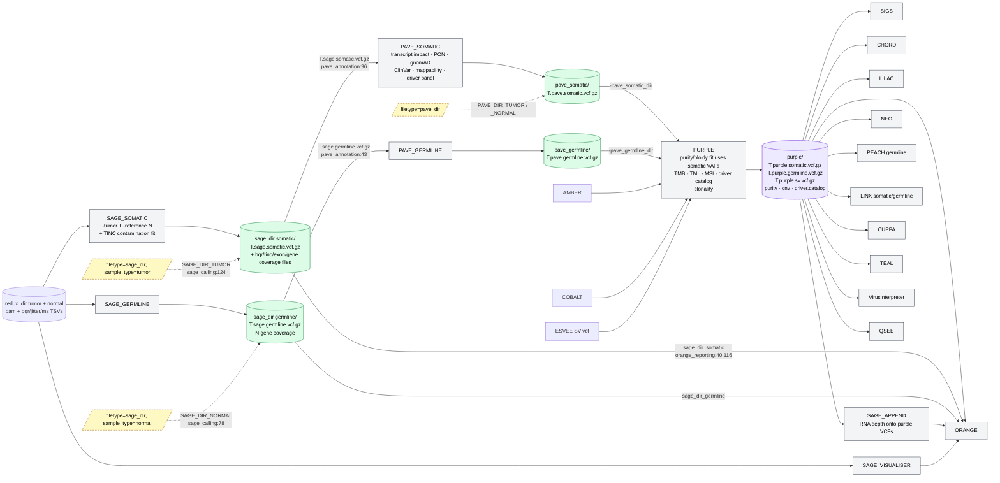

# oncoanalyser wiring around the alignment file and the SNV VCF

Current site BAM entry and verification status: [NATIVE_BAM_ENTRY.md](NATIVE_BAM_ENTRY.md).
Current DeepSomatic experiment and verified/prior-versus-pending boundaries:
[DEEPSOMATIC_SUBSTITUTION.md](DEEPSOMATIC_SUBSTITUTION.md). Its rules supersede
the historical suggestion below to map DeepSomatic filters to PASS: original
filters must be preserved, and no SAGE side outputs or clean normal counts may
be fabricated. Earlier estimates are not current execution evidence.
This wiring assessment includes hypotheses and historical estimates; its blanket
BQSR statements do not establish the processing history of every current BAM.

**Purpose.** Map, from source, exactly what oncoanalyser 3.0.0 does with (a) the DNA alignment file and
(b) the small-variant (SNV/indel) VCF, so that replacing the aligner with Parabricks-aligned BAMs and the
small-variant caller with DeepSomatic can be done as deliberate rewiring rather than guesswork. For each
substitution: which processes break, what data they expect, and which built-in injection points absorb the change.

**Source basis.** nf-core/oncoanalyser **3.0.0**, commit `7c74c87a43` (the version installed on Frontenac),
files `workflows/wgts.nf`, `subworkflows/local/*/main.nf`, `modules/local/*/main.nf`, `lib/Constants.groovy`,
`lib/Utils.groovy`, `docs/usage.md`. Line references are to that commit. Tool versions are those run in our
smoke test: REDUX 2.0.5, SAGE 5.0.2, PAVE 1.9, PURPLE 4.4, ESVEE 2.0.1, AMBER 4.3, COBALT 3.0, ORANGE 5.0.1.
Where a statement rests on hmftools behaviour rather than oncoanalyser code it is marked **[hmftools — verify]**;
the verification target is the hmftools source at the versions above.

---

## 1. The one fact that organises everything

**No downstream DNA tool reads the aligner's BAM. Every one of them reads `<sample_id>.redux.bam` out of the
REDUX output directory**, and SAGE additionally reads REDUX's per-sample TSVs from that same directory.

- The aligner's output goes *only* to REDUX (`wgts.nf:180`, `REDUX_PROCESSING(ch_align_dna_*_out …)`).
- Every consumer resolves its BAM with `Utils.getTumorReduxDirAlignment(meta, redux_dir)` →
  `redux_dir/<sample_id>.redux.bam` (+`.bai`), or `.redux.cram` if present (`lib/Utils.groovy:872-891`).
  Consumers: AMBER (`wgts.nf:282`), COBALT (`:312`), ESVEE (`:341`, `esvee_calling/main.nf:45`), SAGE (`:376`,
  `sage_calling/main.nf:52`), BAMTOOLS, LILAC (`:696`), TEAL, CIDER, VIRUSBREAKEND, SAGE_APPEND, SAGE_VISUALISER, QSEE, WISP.
- SAGE also stages the REDUX TSVs into its work dir (`sage_calling/main.nf:56`, module input
  `path(redux_tsvs)` at `modules/local/sage/somatic/main.nf:13`); the TSV list is
  `redux.bqr.tsv`, `redux.jitter_params.tsv`, `redux.ms_table.tsv.gz`, `redux.duplicate_freq.tsv`,
  `redux.msi_prediction.tsv`, `umi_*.tsv` (`lib/Utils.groovy:906`). SAGE picks them up by `<sample_id>` prefix
  from its working directory **[hmftools — verify: SAGE `-jitter_param_dir`/BQR defaults to cwd]**.

So "replacing the aligner" never touches 15 tool wirings; it touches **one** boundary — what enters REDUX — plus
the question of whether REDUX itself still runs in full.

### 1.1 What REDUX does to the BAM (and what downstream therefore assumes)

`modules/local/redux/main.nf` runs `redux -input_bam … -output_bam redux_<id>/<id>.redux.bam` with:

| Flag (module line) | Effect on the BAM / side outputs | Downstream dependence |
|---|---|---|
| `-form_consensus` (`:61`, Illumina default) | Duplicate groups are collapsed into **consensus reads** (not merely flagged) | SAGE/ESVEE/AMBER/COBALT read-depth and quality models are calibrated on REDUX output **[hmftools — verify]** |
| `-unmap_regions <hmf unmap_regions>` (`:115`) | Reads in known problematic regions are **unmapped** | ESVEE/SAGE artefact suppression relies on it **[hmftools — verify]** |
| BQR (`-bqr_write_plot`) | `<id>.redux.bqr.tsv` — base-quality recalibration table per trinucleotide context | SAGE applies BQR when calling |
| MSI jitter (`-ref_genome_msi_file`) | `<id>.redux.jitter_params.tsv`, `<id>.redux.ms_table.tsv.gz` | SAGE indel/MSI error model; PURPLE MSI in targeted mode |
| duplicate stats | `<id>.redux.duplicate_freq.tsv` | QSEE QC metrics only (`docs/usage.md:333`) |
| `-bqr_jitter_msi_only` (`:89`) | **TSV-only mode**: no BAM is written; the input BAM is symlinked as `<id>.redux.bam` (`:132`) | the documented path for a pre-existing BAM lacking TSVs |

Important identity fact: REDUX is driven by `-sample <sample_id>` and all downstream file resolution is by
`<sample_id>` prefix (`docs/usage.md:337`). The samplesheet `sample_id` must equal the REDUX file prefix; the
BAM `@RG SM` tag is not what the pipeline keys on **[hmftools tools may still read SM — verify per tool]**.

---

## 2. Wiring around the alignment file

```mermaid
flowchart LR
    classDef aln fill:#dbeafe,stroke:#1d4ed8,color:#000
    classDef redux fill:#fde68a,stroke:#b45309,color:#000
    classDef tool fill:#f3f4f6,stroke:#374151,color:#000
    classDef inj fill:#dcfce7,stroke:#15803d,color:#000,stroke-dasharray:5 3

    FQ[FASTQ dna]:::aln --> BWA[READ_ALIGNMENT_DNA<br/>bwa-mem2 -Y -K 1e8<br/>sambamba sort]:::tool
    BWA --> ALN[(aln + idx<br/>per sample)]:::aln
    IN_BAM[/samplesheet filetype=bam or cram/]:::inj -. ALN, skips alignment<br/>Utils.groovy:208 .-> ALN
    ALN --> REDUX[REDUX_PROCESSING<br/>consensus dedup · unmap regions<br/>BQR · MSI jitter]:::redux
    IN_BR[/filetype=bam_redux<br/>info=generate_redux_tsvs_only/]:::inj -. ALN_REDUX → REDUX in -bqr_jitter_msi_only mode<br/>BAM symlinked, TSVs computed<br/>redux/main.nf:89,132 .-> REDUX
    REDUX --> RD[(redux_dir/<br/>id.redux.bam + .bai<br/>id.redux.bqr.tsv<br/>id.redux.jitter_params.tsv<br/>id.redux.ms_table.tsv.gz<br/>id.redux.duplicate_freq.tsv)]:::redux
    IN_RD[/filetype=redux_dir/]:::inj -. REDUX skipped entirely<br/>Utils.groovy:263-305 .-> RD

    RD -->|bam| AMBER[AMBER]:::tool
    RD -->|bam| COBALT[COBALT]:::tool
    RD -->|bam| ESVEE[ESVEE]:::tool
    RD -->|bam + bqr/jitter/ms TSVs| SAGE[SAGE somatic/germline]:::tool
    RD -->|bam| BAMT[BamTools]:::tool
    RD -->|bam| LILAC[LILAC]:::tool
    RD -->|bam| TEAL[TEAL]:::tool
    RD -->|bam| CIDER[CIDER]:::tool
    RD -->|bam| VB[VIRUSBreakend]:::tool
    RD -->|bam| SAPP[SAGE append]:::tool
    RD -->|bam| SVIS[SAGE visualiser]:::tool
    RD -->|duplicate_freq.tsv| QSEE[QSEE]:::tool
    RD -. tsvs only in targeted / purity_estimate modes<br/>wgts.nf:459 passes empty .-> PURPLE[PURPLE]:::tool
```

### 2.1 What the alignment stage records and propagates

| Item | Where it is set | Who depends on it |
|---|---|---|
| Reference genome identity: `GRCh38_masked_exclusions_alts_hlas.fasta` (+ bwa-mem2 index, GRIDSS index, `.img`) | `PREPARE_REFERENCE`; the **same FASTA object** is passed to every tool as `genome_fasta` | REDUX, SAGE, PAVE, PURPLE, ESVEE (`genome_img`), LILAC, VIRUSBreakend (`genome_gridss_index`), CIDER … The BAM header contigs must match this FASTA |
| Read groups: `@RG ID:<sample>.<library>.<lane> SM:<sample_id> LB:<library>` (bwa-mem2 `-R`, from samplesheet `info`) | `READ_ALIGNMENT_DNA` | REDUX merges per-lane BAMs by sample; UMI/duplex options read RG/UMI tags |
| Per-sample `redux_dir` with `<sample_id>.redux.*` files | REDUX | all of §2 |
| REDUX TSVs (BQR, jitter, ms_table) | REDUX | SAGE (calling), QSEE (duplicate_freq), PURPLE (targeted mode only) |
| Alignment QC | BamTools (WGS metrics, flagstats) | QSEE, TEAL, VirusInterpreter (coverage), ORANGE |

### 2.2 Replacing the aligner with Parabricks-aligned BAMs — what breaks and the options

Our existing BAMs (dnaseq_nf) are **Parabricks fq2bam against GRCh38.d1.vd1** (GDC build: primary contigs + decoys +
viral contigs, unmasked), with MarkDuplicates flagging and BQSR applied.

| Concern | Severity | Detail |
|---|---|---|
| **Reference build mismatch** (d1.vd1 vs HMF masked GRCh38) | **Blocking unless addressed** | Every tool receives `genome_fasta`; ESVEE needs the bwa `.img` of *that* genome for assembly realignment; VIRUSBreakend needs the GRIDSS index of *that* genome; contig sets differ (d1.vd1 has `chrUn_*`/viral contigs, HMF has HLA/alt-homologous regions masked). Options: (i) **re-align with Parabricks against the HMF FASTA** (fq2bam is bwa-mem; pass `--bwa-options "-Y -K 100000000"` to match oncoanalyser's flags), or (ii) run oncoanalyser with `--genome CustomGenome` on d1.vd1 (`docs/usage.md` custom genomes; `prepare_reference` builds indexes) and accept that HMF resource files are GRCh38-primary-coordinate based — they are valid on d1.vd1 primary contigs, but masking-dependent behaviour (LILAC HLA, false-duplication regions) is unvalidated **[hmftools — verify]** |
| **Duplicate handling**: Parabricks *flags* duplicates; REDUX *collapses* them into consensus reads | Medium | If REDUX runs in full (option A1 below) the Parabricks flags are irrelevant — REDUX re-processes. If REDUX runs TSV-only (A2), downstream sees flagged-not-collapsed reads; hmftools honour the duplicate flag **[verify per tool]**, but depth/quality distributions differ from what REDUX-trained models expect |
| **Unmapping of problematic regions** | Medium (A2 only) | Only applied by full REDUX. In A2 the `unmap_regions` step never happens → more artefacts for ESVEE/SAGE in those regions |
| **BQSR vs BQR** | Low | Parabricks BQSR rewrites base qualities (GATK model); REDUX BQR is computed *from* the BAM into a TSV that SAGE applies. BQR on an already-BQSR'd BAM is computable but its statistics are shifted — SAGE calls may change at low VAF **[verify]** |
| **Sample identity** | Low, mechanical | `sample_id` in the samplesheet must equal the prefix oncoanalyser expects; with `bam`/`bam_redux` inputs REDUX names outputs after `sample_id`, so any BAM filename works |
| **CRAM** | Low | Supported, but must be CRAM ≤3.0 with the reference embedded and NM tags preserved (`docs/usage.md:291-300`); dnaseq_nf stores CRAM against d1.vd1 — same reference caveat |

**Options (all use built-in injection points; no code change in oncoanalyser):**

- **A1 — `filetype=bam` (recommended for fidelity).** Alignment skipped; REDUX runs in full (consensus, unmap, BQR, jitter).
  Downstream sees a true REDUX BAM. Cost: REDUX ≈ 2 h on a 30× tumour (COLO829 timeline in oncoanalyser docs:
  REDUX tumour 1 h 55 m / 26 GB). Requires the BAM to be against the HMF genome (re-align with Parabricks, see above).
- **A2 — `filetype=bam_redux` + `info=generate_redux_tsvs_only` (recommended for speed, lower fidelity).** REDUX only
  computes BQR/jitter/MS TSVs and symlinks the Parabricks BAM as `<id>.redux.bam`. Minutes instead of hours. Downstream runs
  on a non-REDUX'd BAM. Same reference requirement.
- **A3 — `filetype=redux_dir`** if we ever produce REDUX output ourselves (e.g. in dnaseq_nf); REDUX skipped entirely.

In all three, **nothing downstream is rewired**: the `redux_dir` contract is preserved by oncoanalyser itself.

---

## 3. Wiring around the SNV/indel VCF



### 3.1 What the SNV VCF carries and who uses it

File names are fixed by the subworkflows (`pave_annotation/main.nf:43,96`; `modules/local/sage/somatic/main.nf:104`;
`modules/local/pave/somatic/main.nf:72`): `<tumor_id>.sage.somatic.vcf.gz`, `<tumor_id>.sage.germline.vcf.gz`,
`<tumor_id>.pave.somatic.vcf.gz`. The germline VCF is also named after the **tumor** id.

| Content | Producer | Consumers (and what for) | Confidence |
|---|---|---|---|
| Sample columns: tumour **and** reference (normal, optionally donor) genotypes with `AD`, `DP`, `AF` | SAGE (`-tumor`, `-reference`) | PURPLE (somatic VAF → purity fit, `PURPLE_AF`), PAVE, LILAC, NEO, ORANGE | code: `sage/somatic/main.nf:46-56`; field names **[hmftools]** |
| `TIER` (HOTSPOT / PANEL / HIGH_CONFIDENCE / LOW_CONFIDENCE) and PASS/filter logic per tier | SAGE (hotspots VCF, driver gene panel, high-confidence BED) | PAVE/PURPLE reporting rules, driver catalog, ORANGE | **[hmftools — verify]** |
| `LPS` local phase sets (read-backed phasing) | SAGE | PAVE: phased inframe indels / compound codon changes; NEO: phased neoepitopes | **[hmftools — verify]** |
| Repeat context (`REP_C`, `REP_S`), trinucleotide context (`TNC`), microhomology (`MH`) | SAGE | PURPLE MSI (indels in short repeats), SIGS/CUPPA (SNV-96 contexts), CHORD | **[hmftools — verify]** |
| Read-context quality fields (`RC_*`, `ABQ`, `MMBQ`, `SB`, jitter-adjusted counts) | SAGE using REDUX BQR + jitter TSVs | SAGE's own filtering; PAVE pass-through | **[hmftools]** |
| TINC (tumour-in-normal contamination) fit + `-write_fit_variants` | SAGE somatic (`sage/somatic/main.nf:69`) | ORANGE QC section | code |
| Gene/exon coverage TSVs in `sage_dir` | SAGE | ORANGE (`orange_reporting:116` requires `sage_dir_somatic`/`sage_dir_germline`) | code: dirs are mandatory ORANGE inputs; file list **[verify ORANGE 5.0.1]** |
| PAVE annotations: `IMPACT`, gene/transcript HGVS, `PON_COUNT/PON_MAX`, `GND_FREQ`, `CLNSIG`, `MAPPABILITY`, `REPORTED` | PAVE | PURPLE (TML = missense count; driver catalog; `REPORTED`), ORANGE, NEO, CUPPA | **[hmftools — verify]** |
| PURPLE enrichment: `PURPLE_AF`, `PURPLE_CN`, `PURPLE_VCN`, `PURPLE_MACN`, `SUBCL`, `BIALLELIC`, `KT` | PURPLE | SIGS, CHORD, LILAC (HLA somatic CN), NEO, ORANGE, CUPPA | **[hmftools]** |

### 3.2 Replacing SAGE with DeepSomatic — what breaks

DeepSomatic emits a **single-sample** (tumour) VCF with `GT:GQ:DP:AD:VAF`, PASS/RefCall/GERMLINE filters, no
`TIER`, no phasing (`LPS`), no repeat/trinucleotide context fields, no reference-sample column, and no SAGE side files.

| Breakage | Who notices | Severity |
|---|---|---|
| Missing SAGE INFO fields (`TIER`, `LPS`, `REP_C/REP_S`, `TNC`, `MH`) | PAVE (phasing, tier-aware reporting), PURPLE (MSI indel definition, hotspot-tier rules), SIGS/CUPPA (contexts can be recomputed from the reference, but they read the VCF fields) | **High** |
| Missing reference-sample column | PURPLE somatic fit and `PURPLE_AF` need tumour genotype keyed by `-tumor` id; germline/reference logic expects `-reference` column | **High** |
| Different filter semantics (DeepSomatic `GERMLINE`, `RefCall`, `PON`) | PAVE/PURPLE only consider PASS; everything else dropped | Medium |
| No germline VCF | PURPLE germline, PEACH, LINX germline, ORANGE germline section | **High** unless SAGE_GERMLINE is kept |
| No `sage_dir` side files (TINC, gene coverage) | ORANGE requires the directories | Medium |
| Caller sensitivity profile differs (DeepSomatic FFPE models vs SAGE) | PURPLE purity/ploidy fit changes (the fit uses somatic VAF peaks) — same class of issue already handled by the sibling project's PURPLE fit-review SOP | Medium, scientific |

**Options:**

- **V1 — run SAGE *and* DeepSomatic (no surgery; recommended first).** oncoanalyser stays intact; DeepSomatic runs in
  dnaseq_nf as today. The clinical layer (wigits-clinical) consumes both: SAGE/PAVE/PURPLE-annotated variants drive
  the WiGiTS biomarkers (TMB/MSI/drivers/clonality), DeepSomatic acts as an orthogonal caller for adjudication or as the
  reported SNV set, with the comparison recorded. Zero rewiring; one extra process (SAGE somatic ≈ 1 h on 30×).
- **V2 — inject DeepSomatic through the `sage_dir` entry point.** Provide `filetype=sage_dir` for the tumour pointing
  at a directory containing `<tumor_id>.sage.somatic.vcf.gz` (+`.tbi`) produced by a **SAGE-compatibility adapter**
  that must: add the normal-sample column (genotype/AD/DP from the normal BAM at each site), rename sample columns to
  `tumor_id`/`normal_id`, compute `TNC`, `REP_C/REP_S`, `MH` from the reference, assign `TIER` from the HMF hotspots
  VCF / driver panel BED / high-confidence BED, map DeepSomatic filters to PASS, and leave `LPS` absent (phased
  effects are lost). Keep `SAGE_GERMLINE` running (provide no `sage_dir` for the normal → it runs; `sage_calling:78`).
  Then PAVE → PURPLE → everything else proceed unchanged. This is real work and every item marked
  **[hmftools — verify]** above has to be confirmed against PAVE 1.9 / PURPLE 4.4 readers first.
- **V3 — inject at `pave_dir`.** Worse than V2: the adapter would also have to emulate PAVE annotations.

---

## 4. Rewiring map (what actually has to change)

| Boundary | Current producer | Contract consumed downstream | Parabricks BAM | DeepSomatic VCF |
|---|---|---|---|---|
| Alignment → REDUX | bwa-mem2 per lane | `[meta, [aln…], [idx…]]` → REDUX `-input_bam` | **Use `filetype=bam` (A1) or `bam_redux`+`generate_redux_tsvs_only` (A2)**; no code change. Pre-condition: BAM on HMF GRCh38 FASTA | — |
| REDUX → all DNA tools | REDUX | `redux_dir/<id>.redux.bam(.bai)` + TSVs | Preserved automatically in A1/A2/A3 | — |
| SAGE → PAVE | SAGE somatic/germline | `sage_dir/<tumor_id>.sage.{somatic,germline}.vcf.gz(.tbi)` with SAGE INFO/FORMAT | — | **V2 adapter writes this file**; or V1 leaves SAGE in place |
| PAVE → PURPLE | PAVE | `pave_{somatic,germline}/<tumor_id>.pave.*.vcf.gz` | — | Untouched in V1/V2 |
| PURPLE → 12 consumers | PURPLE | `purple/` directory (VCFs, purity, CNV, driver catalog) | — | Untouched; results shift with caller |
| SAGE dirs → ORANGE | SAGE | `sage_dir_somatic`, `sage_dir_germline` mandatory | — | V2: adapter must also provide what ORANGE 5.0.1 reads from these dirs **[verify]** |
| Reference data | `PREPARE_REFERENCE` | single `genome_fasta` + indexes for all tools | **Re-align to HMF FASTA, or custom-genome run** | — |

---

## 5. Recommended minimal-surgery plan

1. **Alignment**: re-align with Parabricks fq2bam against `GRCh38_masked_exclusions_alts_hlas.fasta` with bwa options
   `-Y -K 100000000`, keep MarkDuplicates, and feed oncoanalyser with `filetype=bam` (A1). Benchmark A1 vs A2 vs
   native bwa-mem2 on the COLO829 / HCC1395 `test_full` data: compare PURPLE purity/ploidy, SAGE PASS counts, ESVEE
   PASS counts, LILAC alleles. Promote A2 only if the deltas are within the fit-review tolerances.
2. **Variant calling**: V1 first (SAGE + DeepSomatic side by side), with a concordance report in the clinical layer.
   Decide on V2 only after the field-level verification against PAVE/PURPLE source is written down in this document.
3. **Everything else unchanged**: AMBER/COBALT/ESVEE/PURPLE/LINX and the reporting tail are not touched by either change.

## 6. Verification tasks (owner: wigits-clinical)

- [ ] Confirm hmftools' reading of REDUX TSVs by SAGE 5.0.2 (cwd lookup by `<sample_id>` prefix).
- [ ] Confirm which `sage_dir` files ORANGE 5.0.1 opens (`-sage_dir`/`-sage_germline_dir`).
- [ ] Confirm PAVE 1.9 and PURPLE 4.4 required INFO/FORMAT fields and sample-column expectations (for V2).
- [ ] Confirm hmftools behaviour on BAMs aligned to an unmasked GRCh38 (LILAC, ESVEE) if the custom-genome route is considered.
- [ ] Run the A1/A2 benchmark on `test_full`.

## Appendix — source anchors (3.0.0, commit 7c74c87a43)

| Topic | File:line |
|---|---|
| Alignment and REDUX calls | `workflows/wgts.nf:139`, `:180` |
| SAGE / PAVE / PURPLE / SAGE_APPEND / ORANGE calls | `workflows/wgts.nf:376`, `:416`, `:452`, `:519`, `:851` |
| PURPLE receives empty REDUX dir in WGTS | `workflows/wgts.nf:459` |
| Samplesheet `bam`/`cram` → generic ALN; `bam_redux` → ALN_REDUX | `lib/Utils.groovy:208`, `:216` |
| REDUX TSV presence checks, `generate_redux_tsvs_only` logic | `lib/Utils.groovy:278-320` |
| `getReduxDirAlignment`, `getReduxTsvs` (file resolution by `sample_id`) | `lib/Utils.groovy:872`, `:900-906` |
| Accepted FileTypes and INPUT key map | `lib/Constants.groovy:96`, `:159` (SAGE_DIR_TUMOR `:261`, PAVE_DIR_TUMOR `:287`) |
| REDUX module flags, TSV-only mode, symlink | `modules/local/redux/main.nf:61`, `:89`, `:115`, `:128`, `:132` |
| SAGE somatic inputs (incl. `redux_tsvs`), TINC, output VCF | `modules/local/sage/somatic/main.nf:13`, `:69`, `:104` |
| PAVE expects `<tumor>.sage.{germline,somatic}.vcf.gz` | `subworkflows/local/pave_annotation/main.nf:43`, `:96` |
| PURPLE inputs (`-pave_somatic_dir`, `-redux_tumor_dir`) | `modules/local/purple/main.nf:15`, `:48`, `:50` |
| ORANGE mandatory SAGE dirs | `subworkflows/local/orange_reporting/main.nf:40`, `:116` |
| Documentation of BAM / REDUX / existing-output entry points | `docs/usage.md:262`, `:320`, `:354`, `:390` |
